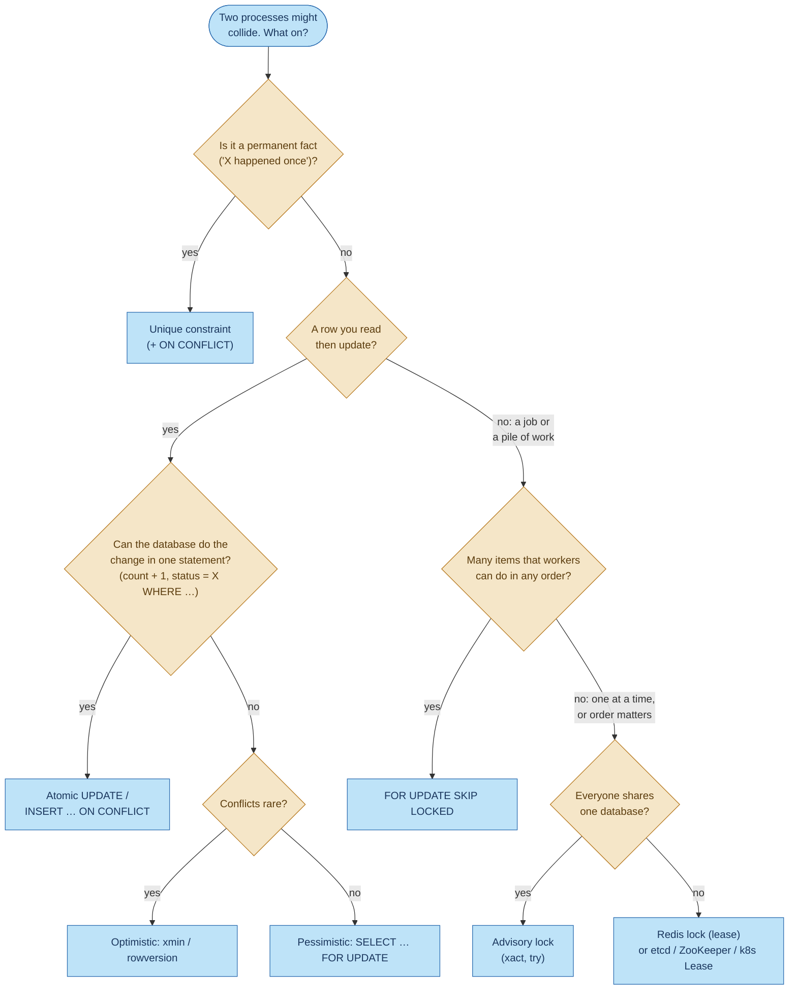

# Concurrency control in BrewQueue: advisory locks, `xmin`, `SKIP LOCKED` and Redis locks

When several processes touch the same data, something has to stop them from getting in each other's
way. BrewQueue runs several API instances, several stats workers and several kitchen workers, and
uses four different tools for this. That's not inconsistency: each solves a **different kind of
problem**.

This document explains:
- each tool: how it works, and its cost
- where BrewQueue uses it
- why it was chosen over the others in that place

Related: [outbox-pattern.md](outbox-pattern.md), [idempotency.md](idempotency.md),
[redis-idempotency.md](redis-idempotency.md).

---

## 1. Four different problems

| Problem | Question it answers | Tool BrewQueue uses |
|---|---|---|
| **One at a time**: a job that only one process may run at once | "Am I allowed to do this job right now?" | **Advisory lock** (outbox publisher) |
| **Lost updates**: two processes edit the same row from stale copies | "Did someone change this row since I read it?" | **`xmin` optimistic concurrency** (orders, stats rows) |
| **Sharing a pile of work**: many workers taking different items from one table | "Which rows can I take that nobody else is working on?" | **`FOR UPDATE SKIP LOCKED`** (*not used now*: it was the outbox's first design) |
| **A claim outside the database**: "first request with this key wins" across instances | "Has anyone claimed this name already?" | **Redis `SET NX EX`** (idempotency keys) |

Most of the confusion around these tools comes from using one for another's problem. Each is
explained below with that in mind.

---

## 2. The tools

### 2.1 Advisory lock: "one at a time" on a name you choose

```sql
SELECT pg_try_advisory_xact_lock(4775232030530094421);   -- true: you have it; false: someone else does
```

- Locks a **number**, not a table or a row. PostgreSQL attaches no meaning to it.
- **Pessimistic:** it stops others *before* they start.
- `try` means don't wait; `xact` means it's released automatically at `COMMIT`/`ROLLBACK`, or if the
  connection dies.
- Advisory: only code that asks for the same number is affected.

**In BrewQueue:** `OutboxPublisher.PublishBatchAsync`. Every API instance tries the lock once per
second. One wins and publishes a batch; the others skip the cycle.

**Costs:**
- Only one process does the work, so throughput is one publisher's.
- The lock is invisible in the schema.
- With PgBouncer transaction pooling, only the `xact` variants are safe.

### 2.2 `xmin`: optimistic concurrency on a row

Every PostgreSQL row has a hidden system column, `xmin`: the id of the transaction that last wrote
it. Each update changes it. Npgsql maps a `uint` property marked `IsRowVersion()` onto it:

```csharp
// BrewQueueDbContext
e.Property(x => x.Version).IsRowVersion();   // Version ↔ xmin
```

When EF saves a change, it adds the version it originally read to the `WHERE` clause:

```sql
UPDATE orders SET "Status" = 'Ready', "UpdatedAt" = @p0
WHERE "Id" = @p1 AND xmin = @p2          -- the xmin we read earlier
RETURNING xmin;                          -- the new one, for the next update
```

- If someone else updated the row in between, `xmin` no longer matches, **0 rows** are updated, and
  EF throws `DbUpdateConcurrencyException`.
- **Optimistic:** nothing is locked while you work. Conflicts are *detected* at write time, and the
  loser retries or reports a conflict.
- It's free: there's no extra column, because PostgreSQL maintains `xmin` anyway.

**In BrewQueue:**
- **`orders`:** `OrderService.ChangeStatusAsync` turns the exception into `409 Conflict`. Two
  simultaneous status changes on one order can't both win, and the loser can reload and retry.
- **`hourly_order_stats` and `item_popularity`:** two stats workers adding to the same hour's
  counters would otherwise overwrite each other's increments. A conflict there is classified as
  **transient**, and the event is retried with fresh data.

**Costs:**
- Under heavy contention on one row, many attempts fail and retry.
- It only protects rows you **read, then write**. It doesn't stop two processes from doing the same
  *work*, only from both *saving* stale results.

### 2.3 `FOR UPDATE SKIP LOCKED`: share a queue table between workers

```sql
BEGIN;
SELECT * FROM outbox_messages
WHERE "ProcessedAt" IS NULL
ORDER BY "Sequence"
LIMIT 200
FOR UPDATE SKIP LOCKED;     -- lock the rows I get; skip rows another transaction has locked
-- ... process them ...
COMMIT;
```

- `FOR UPDATE` row-locks every row returned, until the transaction ends.
- `SKIP LOCKED` means "don't wait for locked rows, just leave them out". Worker A gets rows 1–200,
  worker B, at the same moment, gets 201–400, and so on.
- **Pessimistic, per row**, with **parallel** workers. It's the standard way to build a job queue on
  PostgreSQL, used by Oban, GoodJob, Solid Queue and many hand-written queues.

**In BrewQueue: deliberately not used.** It was the outbox publisher's first design, and it caused
a real bug. Two instances took **different** batches *at the same time*. Instance B could publish
an order's `OrderStatusChanged` (row 201) while instance A was still sending that order's
`OrderPlaced` (row 150). The stats consumer then saw the order's events out of order.
`SKIP LOCKED` gives throughput by giving up ordering, and the outbox needs ordering.

**Costs:**
- No ordering between workers.
- Rows stay locked for the whole processing time, so a crash mid-batch delays them until the
  connection times out.
- Every worker scans past the locked rows.

### 2.4 Redis lock: `SET key value NX EX ttl`

```
SET idempotency:POST:/api/orders:<uuid> '{"state":"Processing",…}' NX EX 30
```

- `NX`: create the key only if it's missing, so exactly one caller gets `OK`.
- `EX 30`: the key expires on its own. That's a **lease**, because Redis can't tell whether the
  holder is still alive.
- It lives **outside** the database, and works across anything that can reach Redis.

**In BrewQueue:** the `Idempotency-Key` filter on `POST /api/orders`. The first request with a key
claims it; repeats get `409` while it runs, or the stored response afterwards.

**Costs:**
- **The lease can end early:** a request slower than 30 s loses its claim without knowing.
- **Not atomic with the database:** the order can commit while saving the response to Redis fails.
- Replication and eviction can silently drop keys (see [redis-idempotency.md](redis-idempotency.md),
  section 7).
- Another system to run.

### 2.5 The tool that's easy to forget: unique constraints

```sql
INSERT INTO processed_events ("EventId", "ProcessedAt") VALUES (@id, now());
-- a second insert of the same EventId fails with unique_violation
```

A primary key or unique index is a lock that **never needs releasing**: the database guarantees
only one row per key, forever. BrewQueue uses it as the backstop in `processed_events`. If two
stats workers race on the same event, only one insert commits, and the loser's
`unique_violation` is retried and then skipped as a duplicate. It's often the simplest correct
answer, and worth trying before reaching for any lock.

---

## 3. Side by side

| | Advisory lock | `xmin` | `FOR UPDATE SKIP LOCKED` | Redis `SET NX EX` |
|---|---|---|---|---|
| Style | Pessimistic | **Optimistic** | Pessimistic | Pessimistic (lease) |
| What's protected | A name (number) you choose | One row's update | The rows a worker took | A key you choose |
| Others while it's held… | Skip (try) or wait | Work freely; one fails at save | Skip those rows, take others | Get `nil` and decide |
| Parallelism | **One** holder | Full | **Many** workers | One holder per key |
| Ordering kept? | Yes (one worker) | n/a | **No** | n/a |
| Released by | Transaction end or dead connection | Nothing to release | Transaction end or dead connection | `DEL`, overwrite, or **TTL** |
| Safe if the holder hangs? | Yes, while its connection is open; it's still "the holder" | n/a | Yes, as advisory | **No**: the TTL expires and a second holder appears |
| Atomic with your database writes? | Yes, same transaction | Yes, it is the write | Yes, same transaction | **No** |
| Extra infrastructure | None | None | None | Redis |
| Works across databases or services | No | No | No | Yes |

---

## 4. Why each choice in BrewQueue

### 4.1 Outbox publishing → **advisory lock**

**Requirement:** publish every order's messages **in `Sequence` order**, even with several API
instances. Fail over automatically if one dies.

| Option | Verdict |
|---|---|
| **Advisory lock** ✅ | One publisher at a time keeps the order. The lock is held by the same transaction that reads and marks the rows, so a crash releases it. It needs nothing beyond PostgreSQL. |
| `FOR UPDATE SKIP LOCKED` ❌ | Parallel batches break per-order ordering: the bug described in 2.3 |
| `xmin` ❌ | It detects a conflict only when *saving* `ProcessedAt`. By then both instances have already **published** the batch, so the damage (duplicates, reordering) is done. Optimistic checks can't protect side effects outside the database. |
| Redis lock ⚠️ | Would work, but adds a lease that can expire while a slow batch is still publishing, plus a second system the publisher depends on. No advantage here. |

The price is that publishing throughput is one instance's. Pipelined Kafka sends make that
thousands of messages per second, far beyond what a café needs. If it ever weren't enough, the
next step would be to **partition** the work: one advisory lock per bucket of order ids. Each order
stays in one lane, and the buckets run in parallel. Plain `SKIP LOCKED` wouldn't be the fix.

### 4.2 Order status changes → **`xmin`**

**Requirement:** two simultaneous status changes on one order (for example, the kitchen's `Ready`
and a staff `Cancelled`) must not silently overwrite each other.

| Option | Verdict |
|---|---|
| **`xmin`** ✅ | Conflicts are rare (one order, a few changes a minute). Optimistic means no locks held and no waiting. The loser gets a clear `409`. It's free, and EF supports it directly. |
| `SELECT … FOR UPDATE` ⚠️ | Correct too: the second request waits, then sees the new status. But it holds a row lock for the whole request, for a conflict that almost never happens. |
| Advisory lock per order id ⚠️ | Works, but it's a hand-built version of what row locks already give you |
| Redis lock ❌ | Not atomic with the row update, and adds a dependency for no gain |

### 4.3 Stats counters → **`xmin` + retry**, though there's a better option

**Requirement:** several stats workers add to the same hourly row (`OrdersPlaced++`,
`Revenue += …`) without losing increments.

The current code reads the row, changes it in C#, and saves with an `xmin` check. A conflict throws,
and `FailureClassifier` marks it transient, so the event is retried. That's correct, but it's a
read-modify-write loop that can retry often when many events hit the same hour.

**A better option for counters is no lock at all.** Let the database do the increment atomically:

```sql
INSERT INTO hourly_order_stats ("HourStart", "OrdersPlaced", "Revenue")
VALUES (@hour, 1, @total)
ON CONFLICT ("HourStart") DO UPDATE
SET "OrdersPlaced" = hourly_order_stats."OrdersPlaced" + 1,
    "Revenue"      = hourly_order_stats."Revenue" + EXCLUDED."Revenue";
```

There's no stale read, so there's nothing to conflict on. The row lock lasts only for this one
statement, and it also removes the insert race on a new hour's row. `xmin` was kept to show
optimistic concurrency in action; for pure counters, an atomic update is the stronger choice.

### 4.4 Idempotency keys → **Redis `SET NX EX`**, though the database would be stronger

**Requirement:** of several requests with the same `Idempotency-Key`, exactly one creates an order,
and the others get its result.

| Option | Verdict |
|---|---|
| **Redis `SET NX EX`** ✅ (current) | Fast, keys expire on their own, and it shows the Redis lock pattern clearly. Its weak spots are covered in 2.4. |
| Unique key in PostgreSQL, in the same transaction as the order ⭐ | The **strongest** option. Claiming the key, inserting the order and storing the response commit together. There's no lease and no "order without record" gap. See [redis-idempotency.md](redis-idempotency.md), section 7.2. |
| Advisory lock on a hash of the key | `pg_try_advisory_xact_lock(hashtext(key))` inside the order transaction stops concurrent duplicates. But it doesn't **remember** the result for later retries, so it still needs a table: at that point, use 2.5. |
| `xmin` / `SKIP LOCKED` ❌ | Wrong problem: there's no existing row to update, and no queue to share |

### 4.5 Processed events → **unique constraint**

Covered in 2.5. Deduplication is a permanent fact ("event E was handled"), not a temporary claim, so
a primary key is exactly the right tool.

---

## 5. Choosing in general



Rules of thumb:
1. **Prefer no lock:** a unique constraint or an atomic statement beats any lock when it fits.
2. **Optimistic when conflicts are rare, pessimistic when they're common.** Optimistic is cheap
   until it retries constantly.
3. **A lock should live where the data lives.** If the protected work is a database transaction,
   lock inside that transaction, so the lock and the writes succeed or fail together.
4. **Optimistic checks can't undo side effects.** If the work sends messages, calls APIs or charges
   cards, make sure only one process does it *before* it starts (a pessimistic lock or a claim), or
   make the side effect idempotent.
5. **A lease (TTL) lock is only as safe as its timeout.** Use one when there's no shared database
   to tie the lock to, and size the TTL well above the worst-case run time.

---

## Where the code lives

| Tool | Where | File |
|---|---|---|
| Advisory lock | Outbox publisher | `src/BrewQueue.Api/Services/OutboxPublisher.cs` (`PublisherLockKey`, `PublishBatchAsync`) |
| `xmin` | Orders | `src/BrewQueue.Domain/Order.cs` (`Version`), `BrewQueueDbContext.cs`, `OrderService.ChangeStatusAsync` (→ `409`) |
| `xmin` | Stats rows | `src/BrewQueue.Infrastructure/Persistence/Entities.cs`, `OrderEventProcessor.cs` (`FailureClassifier`) |
| `SKIP LOCKED` | (replaced; history in) | [outbox-pattern.md](outbox-pattern.md) step 6.1, [kafka-production.md](kafka-production.md) |
| Redis `SET NX EX` | Idempotency keys | `src/BrewQueue.Infrastructure/Idempotency/Idempotency.cs`, `src/BrewQueue.Api/CrossCutting/IdempotencyFilter.cs` |
| Unique constraint | Processed events | `processed_events` in `BrewQueueDbContext.cs`, `OrderStatsProjector.cs` |
