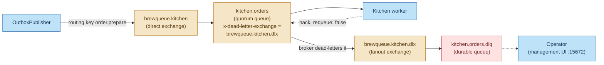
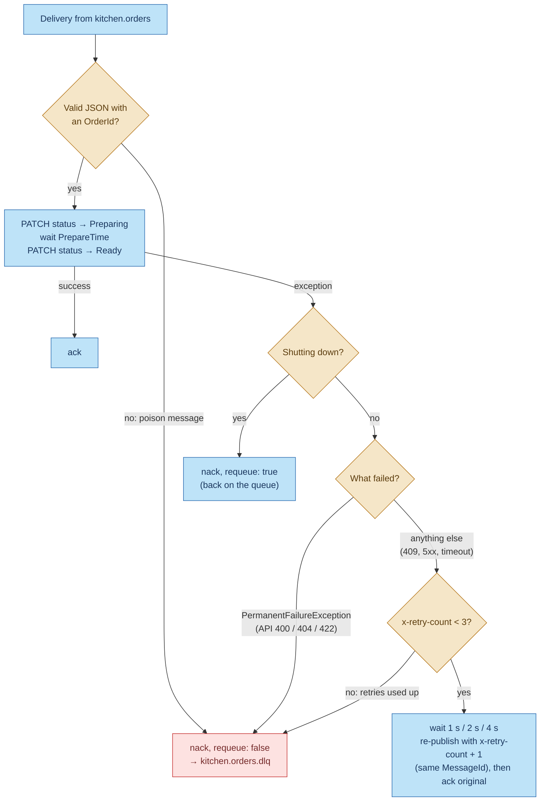
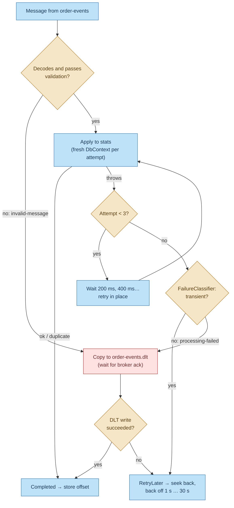
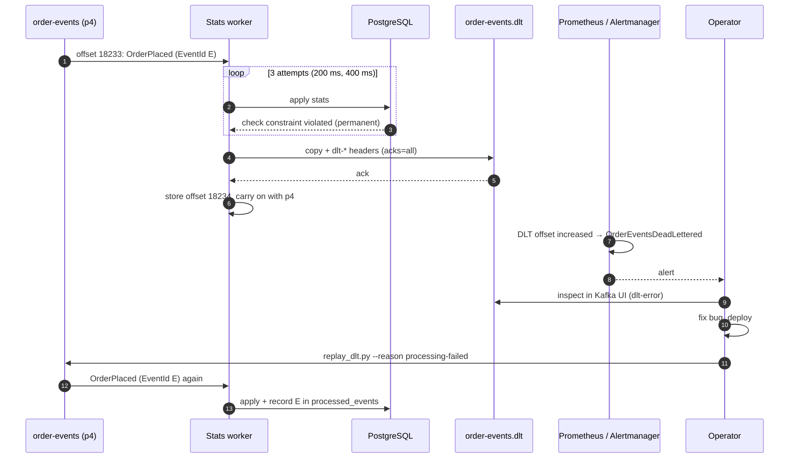

# Dead letters in BrewQueue

A **dead-letter queue (DLQ)** is where a consumer puts a message it has given up on, so that one bad
message can't block, crash or endlessly loop the consumer, and so a human can still inspect it and
replay it later.

BrewQueue has two, one per broker:

| | RabbitMQ | Kafka |
|---|---|---|
| Name | `kitchen.orders.dlq` (queue) | `order-events.dlt` (topic: a "dead-letter topic") |
| Fed by | The **kitchen worker**, via a dead-letter exchange | The **stats worker**, which publishes to it itself |
| How a message gets there | The consumer *rejects* it; **the broker** moves it | The consumer *copies* it there, then moves past the original |
| Diagnostics | RabbitMQ's automatic `x-death` header | Our own `dlt-*` headers |
| Alert | none yet (see step 6) | `OrderEventsDeadLettered` |
| Replay | By hand in the management UI | `infra/kafka/replay_dlt.py` |

The two work differently because the brokers do: RabbitMQ has dead-lettering built in, while Kafka
has no such feature, so the consumer has to do it.

Related: [messaging-workflow.md](messaging-workflow.md), [idempotency.md](idempotency.md),
[kafka-production.md](kafka-production.md).

---

## 1. The rule both sides follow: dead-letter only what retrying can't fix

The hardest part of a DLQ isn't sending messages there; it's deciding **when**. Both workers sort
every failure into one of two kinds:

| Kind | Examples | What happens |
|---|---|---|
| **Permanent**: the message itself is the problem | Invalid JSON or Protobuf, an empty message, an unknown status, the API answering `400`/`404`/`422`, a database constraint violation | Dead-letter. It would fail the same way forever. |
| **Transient**: the environment is the problem | Database or API down, timeout, `5xx`, `409` conflict, a concurrency clash | Retry. It will very likely work once the outage ends. |

Getting this wrong is costly either way:
- **Dead-lettering a transient failure** means that during a 10-minute database outage, every event
  in those 10 minutes ends up in the DLQ, and someone has to replay them all.
- **Retrying a permanent failure forever** is a *poison message*: the consumer spins on it, and
  everything behind it waits.

---

## 2. RabbitMQ: the kitchen dead-letter queue

### 2.1 Topology

Declared at startup by `RabbitMqTopology.DeclareAsync` (`src/BrewQueue.Infrastructure/Messaging/RabbitMq.cs`):



- The work queue's `x-dead-letter-exchange` argument tells RabbitMQ where to send messages it
  removes from the queue as dead. The worker never addresses the DLQ directly.
- The dead-letter exchange is a **fanout**, so it ignores routing keys: everything sent to it lands
  in `kitchen.orders.dlq`, whatever key the message had.
- Every process declares the same topology at startup. Repeated declarations are no-ops, so start-up
  order doesn't matter.

### 2.2 How the kitchen decides

`KitchenConsumer.HandleAsync` (`src/BrewQueue.KitchenWorker/KitchenConsumer.cs`) handles each
`PrepareOrderCommand` with manual acks:



| Situation | Result | Attempts before the DLQ |
|---|---|---|
| Body isn't valid JSON, or has no `OrderId` | Dead-lettered immediately | 1 |
| API returns `400`, `404` (unknown order) or `422` (invalid transition) | Dead-lettered immediately | 1 |
| API returns `409` or `5xx`, or times out | Retried after 1 s, 2 s, then 4 s (`RetryPolicy`) | 4 (the first try plus 3 retries) |
| Worker shutting down mid-order | Requeued, not dead-lettered | — |

There are two retry layers:
1. **Inside one attempt:** the API client's `AddStandardResilienceHandler` retries each individual
   HTTP call a few times, so short blips never surface as failures.
2. **Across attempts:** the message is re-published to the back of the queue with an incremented
   `x-retry-count` header, then the original is acked. The count travels with the message, so the
   limit holds even if a different worker instance picks up the retry.

Why re-publish instead of `nack(requeue: true)`? A requeued message goes straight back to the
consumer with no delay and no counter: the classic poison-message loop.

### 2.3 What a dead-lettered message looks like

RabbitMQ keeps the original body and properties (`MessageId` = the outbox row id, `CorrelationId`,
`x-message-type`, `x-retry-count`) and adds an `x-death` header:

| `x-death` field | Example | Meaning |
|---|---|---|
| `reason` | `rejected` | Nacked without requeue (other values: `expired`, `maxlen`, `delivery_limit`) |
| `queue` | `kitchen.orders` | Where it was dead-lettered from |
| `exchange`, `routing-keys` | `brewqueue.kitchen`, `order.prepare` | Where it was originally published |
| `count` | `1` | How many times it has been dead-lettered for this reason from this queue |
| `time` | timestamp | When |

RabbitMQ also sets `x-first-death-reason`, `x-first-death-queue` and `x-first-death-exchange`. The
*reason for the failure* isn't in the message; find it in Seq by searching for the
`CorrelationId` or `MessageId`. The worker logs `Poison message (invalid JSON); dead-lettering` or
`Order {OrderId} failed permanently after {Retries} retries; dead-lettering`.

### 2.4 A third route: the quorum queue's delivery limit

`kitchen.orders` is a **quorum queue**, and since RabbitMQ 4.0 quorum queues have a default
**delivery limit of 20**. A message redelivered more than 20 times (for example, a worker that
crashes on it every time before acking) is dead-lettered by the broker with
`reason: delivery_limit`, even though the code never nacked it. That's a useful safety net against
crash loops the code can't catch.

### 2.5 Handling it

1. Open `http://localhost:15672` → **Queues** → `kitchen.orders.dlq` → **Get messages** (choose
   "Nack message requeue true" to look without removing).
2. Read `x-death` and the `MessageId`, and find the error in Seq.
3. Fix the cause. Then either:
   - re-publish it to `brewqueue.kitchen` with routing key `order.prepare` from the UI (**Publish
     message**), setting `x-retry-count` to `0`, or
   - move the whole queue with the Shovel plugin (`rabbitmq-plugins enable rabbitmq_shovel
     rabbitmq_shovel_management`, then **Move messages** on the queue page).
4. Or, if the order shouldn't be prepared, cancel it (`PATCH /api/orders/{id}/status` → `Cancelled`)
   and purge the message.

Re-processing is safe because the kitchen's steps are idempotent: setting a status the order
already has does nothing (see [idempotency.md](idempotency.md), step 4.4).

---

## 3. Kafka: the dead-letter topic `order-events.dlt`

Kafka has no dead-lettering. A consumer reads a partition as an ordered log and tracks its position
with an offset, so it can't "reject" one message. It can only stop at it or move past it. The DLT
is how the stats worker moves past a bad message **without losing it**.

### 3.1 The topic

Created by `infra/kafka/setup-kafka.sh`:

| Setting | `order-events` | `order-events.dlt` | Why |
|---|---|---|---|
| Partitions | 6 | 6 | Same keys spread the same way |
| Replication factor / `min.insync.replicas` | 3 / 2 | 3 / 2 | A dead letter is as important as the original |
| Retention | 14 days | **30 days** | Time to investigate, fix and replay |

ACLs: the `stats` user may **write** and describe `order-events.dlt`, and nothing else on that
topic. Only `admin` (the replay script) writes back to `order-events`.

### 3.2 How the stats worker decides

`OrderEventProcessor.ProcessAsync` (`src/BrewQueue.Infrastructure/Stats/OrderEventProcessor.cs`)
returns one of two outcomes: `Completed` (move past this offset) or `RetryLater` (don't).



| Situation | `dlt-reason` | Attempts |
|---|---|---|
| Not valid Confluent-framed Protobuf, unknown schema id | `invalid-message` | 1 |
| Empty value or tombstone | `invalid-message` | 1 |
| Valid Protobuf that breaks the contract (an id that isn't a UUID, missing status, unsupported event type…) | `invalid-message` | 1 |
| Applying it throws a **permanent** error (a bug, a constraint violation) | `processing-failed` | 3 |
| Applying it throws a **transient** error (`FailureClassifier.IsTransient`: database down, timeout, `xmin` conflict, unique-key race) | — never dead-lettered | retried until it works |

**Transient failures never go to the DLT.** The consumer `Seek`s back to the same offset and waits,
doubling from 1 s to 30 s. The 30 s cap is far below `max.poll.interval.ms` (5 minutes), so the
worker stays in its consumer group. Lag grows meanwhile, and the `StatsConsumerStuck` /
`StatsConsumerLagHigh` alerts tell a human.

**"If we can't park it, we mustn't skip it."** The offset is stored only after the DLT write is
**acknowledged by the brokers** (`acks=all`, idempotent producer). If the DLT write fails,
`DeadLetterAsync` returns `RetryLater` and the message is tried again, so it is never lost in
between.

### 3.3 What a dead-lettered event looks like

`KafkaDeadLetterPublisher` (`src/BrewQueue.Infrastructure/Messaging/DeadLetterPublisher.cs`) writes
an **exact copy**: the same key (the order id, so the same DLT partition), the same value bytes
(still schema-registry framed), and all original headers (`x-correlation-id`, `x-message-type`).
It then adds:

| Header | Example |
|---|---|
| `dlt-original-topic` | `order-events` |
| `dlt-original-partition` | `4` |
| `dlt-original-offset` | `18233` |
| `dlt-reason` | `invalid-message` or `processing-failed` |
| `dlt-error` | `InvalidEventException: event_id 'abc' is not a valid UUID.` (max 1,000 characters) |
| `dlt-attempts` | `3` |
| `dlt-failed-at` | `2026-10-26T09:41:07.1234567+00:00` |

The original bytes are kept untouched on purpose: after a fix, the *same* message can be replayed,
and it carries its original `EventId`, so deduplication still works.

### 3.4 Alerting

`infra/monitoring/alerts.yml`:

```yaml
- alert: OrderEventsDeadLettered
  expr: sum(increase(kafka_topic_partition_current_offset{topic="order-events.dlt"}[10m])) > 0
```

Any new message on the DLT within 10 minutes fires a warning through Alertmanager. The DLT should
normally be **empty**, so a single message is worth a look. The data comes from kafka-exporter →
Prometheus, and the rule is covered by `infra/monitoring/alerts.test.yml` (`promtool test rules`).

### 3.5 Replaying

The runbook is in [kafka-production.md](kafka-production.md) ("Runbook: replaying dead letters"):

```bash
# 1. Look: Kafka UI (http://localhost:8081) → Topics → order-events.dlt → Messages → headers
# 2. Fix the cause and deploy
# 3. Replay
pip install confluent-kafka
export KAFKA_ADMIN_PASSWORD=...                       # from .env
python3 infra/kafka/replay_dlt.py --dry-run           # list what would be replayed
python3 infra/kafka/replay_dlt.py --reason processing-failed
```

`replay_dlt.py`:
- reads every DLT partition from the start up to its current end, then stops, using a throwaway
  consumer group that never commits (so reading changes nothing)
- can filter with `--reason`, e.g. replay `processing-failed` after a bug fix but leave
  `invalid-message` garbage alone
- re-produces each message to `order-events` with the original key, value and headers, minus the
  `dlt-*` ones, using an idempotent, `acks=all` producer
- **doesn't delete anything from the DLT**: Kafka topics can't delete single messages, and the
  copies expire after 30 days

**Replaying twice is safe:** the stats worker records each `EventId` in `processed_events` and skips
repeats. Dead-lettered events were never recorded there, so the first replay is applied normally.

---

## 4. Does dead-lettering break ordering?

It can, and it's worth being clear about where.

**Kafka.** Events for one order share a partition and are processed in order. If event #2 of an
order is dead-lettered, #3 is processed next, **without #2**. A replay later appends #2 *after*
#3. For BrewQueue's stats that's harmless: the projection only adds counts (orders placed, revenue,
items sold, orders collected), and addition doesn't care about order. A consumer that keeps
"latest status per order" would need more care. Options:
- check a per-order version and ignore older events
- stop and park *all later events for the same key* once one is dead-lettered (some systems do
  this)
- don't dead-letter for that consumer at all

**RabbitMQ.** The kitchen queue makes no ordering promise to begin with: with prefetch 10, several
consumers and re-published retries, commands already run out of order. Each command is about a
different order, so nothing depends on it.

The alternative, *never* dead-lettering, would keep the order perfect, but one bad event would
then stop its whole partition (a sixth of all orders) until a human intervened. The project
chooses to keep the stream moving and make the gap loud.

---

## 5. End-to-end example

A `processing-failed` event on Kafka, with real values:



---

## 6. Known gaps

| Gap | Effect | Fix |
|---|---|---|
| **No alert on `kitchen.orders.dlq`** | A dead-lettered `PrepareOrderCommand` leaves its order stuck at `Received`, and nobody is told. The customer just waits. | Enable RabbitMQ's Prometheus plugin (`rabbitmq_prometheus`, port 15692), scrape it, and alert on `rabbitmq_queue_messages_ready{queue="kitchen.orders.dlq"} > 0`. |
| **No replay tool for RabbitMQ** | Replays are manual, one message at a time in the UI. | A small script like `replay_dlt.py` that moves messages back with `x-retry-count` reset, or the Shovel plugin. |
| **RabbitMQ's dead-lettering from quorum queues is at-most-once by default** | If the DLQ can't accept a message at that moment, it can be dropped. | Declare `kitchen.orders` with `x-dead-letter-strategy: at-least-once` and `x-overflow: reject-publish` (and make the DLQ a quorum queue too). Changing queue arguments means deleting and recreating the queue. |
| **Late kitchen redelivery is wrongly dead-lettered** | If the kitchen crashes after setting `Ready` but before acking, the redelivery fails with `Ready → Preparing` (`422`) and goes to the DLQ, even though the work was done. | Skip steps the order is already past (see [idempotency.md](idempotency.md), step 6). |
| **The DLT can't be emptied message by message** | After a replay, the replayed copies stay in the DLT until retention expires, and could be replayed again by mistake. | Harmless thanks to `EventId` deduplication. For tidiness, record the last replayed offset, or use `kafka-delete-records.sh` up to an offset. |
| **Kitchen backoff holds a prefetch slot** | While a worker waits 1–4 s before re-publishing, that message occupies one of its 10 prefetch slots. | Fine at this scale. At high volume, use delayed retry queues (a TTL queue that dead-letters back to the work queue) instead of `Task.Delay`. |

---

## 7. How it's tested

| Test | What it proves |
|---|---|
| `MessagingTests.Rejected_messages_are_dead_lettered` (integration, real RabbitMQ) | A message nacked without requeue arrives in `kitchen.orders.dlq` with its `MessageId` |
| `RetryPolicyTests.ShouldRetry` / `Backoff_is_exponential` (unit) | Transient failures retry up to 3 times at 1 s, 2 s, 4 s; permanent ones never retry |
| `DeadLetterTests.Undecodable_message_is_copied_to_the_dead_letter_topic_with_diagnostics` (integration, real Kafka) | Garbage bytes on `order-events` end up on the DLT with the same key and bytes, the original topic and offset, `dlt-reason: invalid-message` and an error. The processor returns `Completed` and never applies it. |
| `OrderEventProcessorTests` (unit) | Garbage, tombstones and contract-breaking Protobuf are dead-lettered; a transient failure that clears is retried in place; a persistent transient failure returns `RetryLater` and **never** dead-letters; a permanent failure is dead-lettered after 3 attempts; if the DLT is unavailable the message isn't skipped |
| `alerts.test.yml` (`promtool test rules`) | `OrderEventsDeadLettered` fires when the DLT grows |

---

## Where the code lives

| What | File |
|---|---|
| Queue, exchange and topic names; `dlt-*` header names | `src/BrewQueue.Contracts/Messaging.cs` |
| RabbitMQ topology (DLX + DLQ) and `RetryPolicy` | `src/BrewQueue.Infrastructure/Messaging/RabbitMq.cs` |
| Kitchen ack / retry / nack decisions | `src/BrewQueue.KitchenWorker/KitchenConsumer.cs` |
| Permanent vs transient API responses | `src/BrewQueue.KitchenWorker/BrewQueueApiClient.cs` |
| Kafka retry / dead-letter decisions, `FailureClassifier` | `src/BrewQueue.Infrastructure/Stats/OrderEventProcessor.cs` |
| DLT publisher | `src/BrewQueue.Infrastructure/Messaging/DeadLetterPublisher.cs` |
| Seek-back and offset storing | `src/BrewQueue.StatsWorker/OrderEventsConsumer.cs` |
| DLT topic config and ACLs | `infra/kafka/setup-kafka.sh` |
| Replay script | `infra/kafka/replay_dlt.py` |
| Alert rule and its test | `infra/monitoring/alerts.yml`, `infra/monitoring/alerts.test.yml` |
