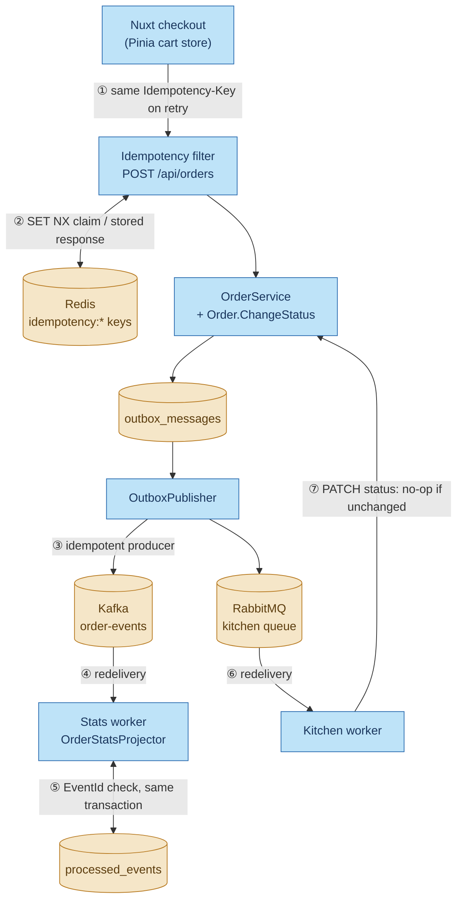
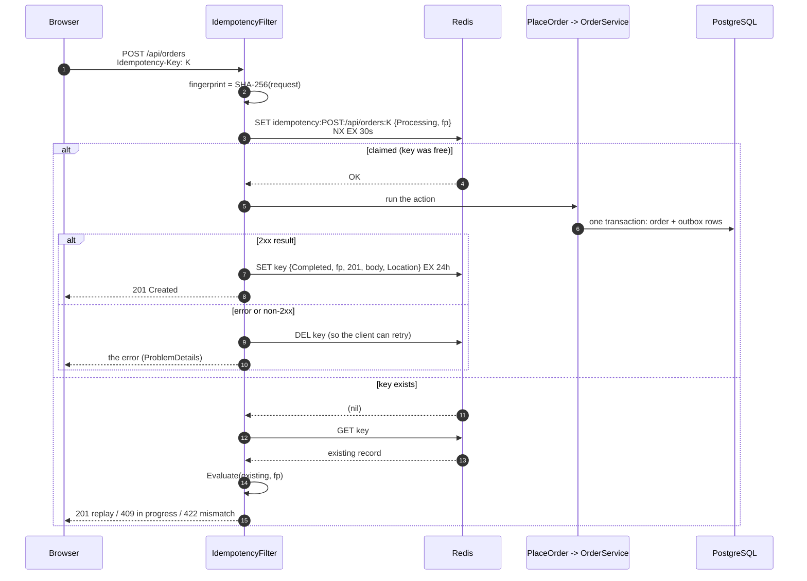
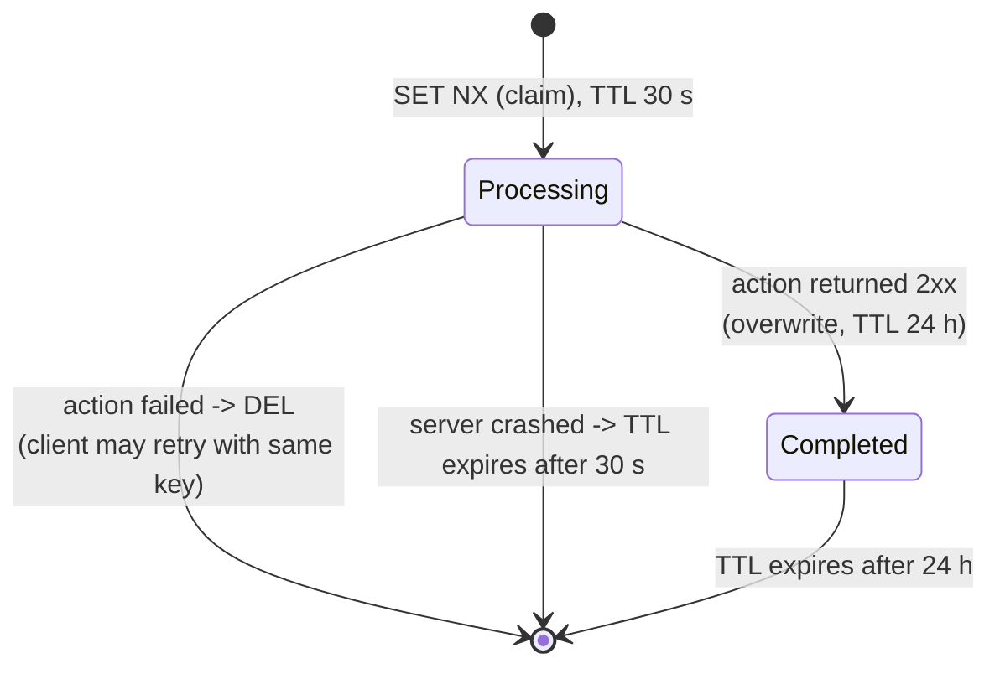
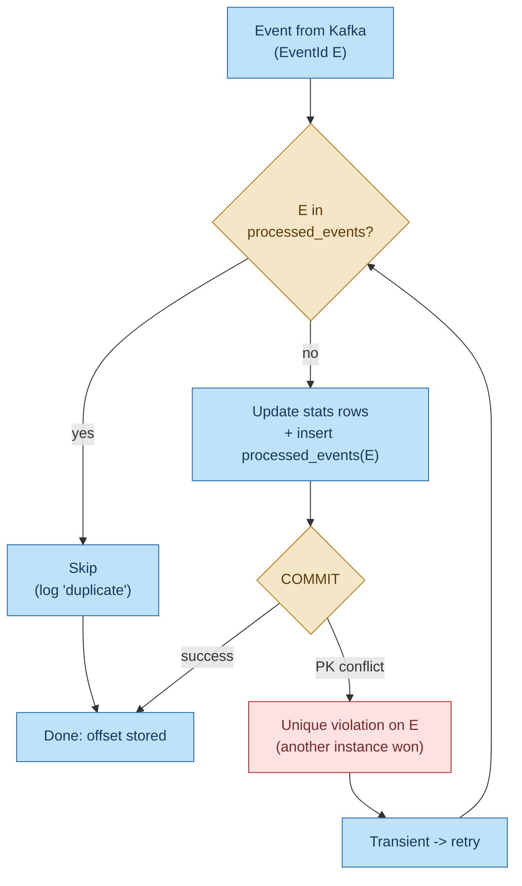

# Idempotency in BrewQueue

An operation is **idempotent** when doing it twice has the same effect as doing it once. BrewQueue
needs this because almost every hop in the system can repeat itself:
- browsers retry after a network error
- the outbox publishes **at least once**
- Kafka and RabbitMQ redeliver anything that wasn't acknowledged
- workers retry failed steps

This document walks through every place the project protects against duplicates, end to end, how
each one works, and where the remaining gaps are.

Related: [outbox-pattern.md](outbox-pattern.md), [messaging-workflow.md](messaging-workflow.md),
[kafka-production.md](kafka-production.md).

---

## 1. Where duplicates come from, and what stops each one



| # | Duplicate source | Protection | Where |
|---|---|---|---|
| ① | User clicks "Place order" again after a timeout | The browser reuses the same `Idempotency-Key` for the same cart | `web/app/stores/cart.ts` |
| ② | The same POST arrives twice (retry, double submit, proxy retry) | Redis claim + stored response replay | `IdempotencyFilter.cs`, `Idempotency.cs` |
| ③ | Kafka producer retries a send whose ack was lost | Kafka's idempotent producer: the broker drops the repeat | `Kafka.cs` (`DurableProducer`) |
| ④ | The outbox re-publishes, or Kafka redelivers after a rebalance or crash | Each event has a fixed `EventId` | `OrderService.ToEvent` |
| ⑤ | The stats worker sees the same event twice | `processed_events` table, updated in the same transaction as the stats | `OrderStatsProjector.cs` |
| ⑥ | RabbitMQ redelivers an unacked `PrepareOrderCommand` | The kitchen's actions are status changes, which can be repeated safely | `KitchenConsumer.cs` |
| ⑦ | The same status PATCH is sent twice | `Order.ChangeStatus` returns `false` (no-op, no event) if the status is already set | `Order.cs`, `OrderService.ChangeStatusAsync` |

The three main techniques are:
- **Idempotency keys** (①, ②): the *client* names the operation, so the server can recognise a repeat.
- **Deduplication by message id** (③, ④, ⑤): the *producer* names each message, and the consumer
  remembers which ids it has handled.
- **Naturally idempotent operations** (⑥, ⑦): "set status to Ready" means the same thing however
  many times it runs. Compare "add one to the count", which doesn't.

---

## 2. The HTTP layer: `Idempotency-Key` on `POST /api/orders`

Placing an order is the one operation that is **not** naturally idempotent: two identical POSTs
would create two orders, and charge the customer twice. So the endpoint requires an
`Idempotency-Key` header, following the IETF *Idempotency-Key HTTP Header Field* draft.

```csharp
[HttpPost]
[Idempotent]
public async Task<ActionResult<OrderDto>> PlaceOrder(
    [FromHeader(Name = "Idempotency-Key"), Required] Guid? idempotencyKey,
    [FromBody] PlaceOrderRequest request, CancellationToken ct)
```

`[Idempotent]` attaches `IdempotencyFilter`, an action filter that runs around the controller action.

### 2.1 The client side: one key per checkout attempt

`web/app/stores/cart.ts` (Pinia) owns the key:

| Event | `checkoutKey` |
|---|---|
| First click on "Place order" | `crypto.randomUUID()` creates one |
| Click again after an error or timeout | **Same key reused**, so the server replays the result instead of creating a second order |
| Cart changes (add, quantity, remove, name) | Reset to `null`, because a different cart is a different order |
| Order succeeds | Reset (`clear()`) |

On a replayed response (`Idempotent-Replayed: true`), the page shows "Order already placed: we had
already received this order, so we did not charge you twice." CORS exposes `Idempotent-Replayed`
and `Location` so the browser can read them.

### 2.2 What's stored in Redis

One key per request, scoped by method and path so the same UUID can't collide across endpoints:

```
idempotency:POST:/api/orders:3f0c9a8e-5b1d-4e8a-9c41-6f2b7d0e1a55
```

The value is an `IdempotencyRecord` as JSON:

| Field | Meaning |
|---|---|
| `State` | `Processing` (a request holds the key) or `Completed` (a response is stored) |
| `Fingerprint` | SHA-256 of the request, to detect the same key reused with a different body |
| `StatusCode`, `ResponseBody`, `Location` | The original response, replayed byte for byte (only when `Completed`) |

**The fingerprint** is taken over the *bound action arguments* (the deserialized `PlaceOrderRequest`),
excluding the key itself and the `CancellationToken`. They're sorted by name, serialized with the
API's JSON options, then hashed. Because it hashes the parsed object rather than the raw bytes,
differences in whitespace or property order in the client's JSON don't matter.

### 2.3 The decision

`IdempotencyEvaluator.Evaluate` is a pure function, kept apart from Redis so it can be unit-tested:

| Existing record | Fingerprint | Decision | Response |
|---|---|---|---|
| none (we just claimed it) | — | **Proceed** | Run the action |
| `Completed` | same | **Replay** | The stored status and body, `Location`, plus `Idempotent-Replayed: true` |
| `Processing` | same | **InProgress** | `409 Conflict`, `Retry-After: 1`, `errorCode: idempotency_in_progress` |
| any | different | **PayloadMismatch** | `422`, `errorCode: idempotency_key_reused` |

A missing or non-UUID key is rejected with `400` before any of this runs.

### 2.4 The request flow



Why `SET … NX` matters: **claiming** the key is a single atomic Redis command. If five identical
requests arrive at once (the integration test `Concurrent_requests_with_the_same_key_create_exactly_one_order`
does exactly this), exactly one gets `OK` and runs the action. The other four see `Processing` and
get `409`. A plain "GET, then SET if missing" would let several through between the GET and the SET.

One subtle case is handled in `TryClaimAsync`: if the claim fails but the key has expired by the
time of the follow-up `GET`, the store treats it as `Processing`. That's the safe answer, and
returns `409` rather than risking a second execution.

### 2.5 Lifecycle of a key



- **Only successes are cached.** Validation errors, `422` business-rule failures and `500`s release
  the key. Caching a failure would make a retry pointless, for example after the menu item
  becomes available again.
- The `Completed` write deliberately **overwrites** the `Processing` value (`StringSetAsync` with no
  `When` condition): this request owns the key, so replacing it is correct.
- The 30-second lock TTL is a crash safety net. If the API dies mid-request, the key frees itself
  rather than locking that checkout out for a day.

### 2.6 Settings

`appsettings.json` -> `Idempotency` (`IdempotencyOptions`):

| Setting | Default | Effect |
|---|---|---|
| `LockTtl` | `00:00:30` | How long a `Processing` claim survives a crashed request. Must be longer than the slowest request. |
| `ResponseTtl` | `1.00:00:00` | How long a completed response can be replayed. Retries later than this create a new order. |

---

## 3. The status endpoint: idempotent by design

`PATCH /api/orders/{id}/status` needs no key, because "set the status to X" is naturally idempotent:

```csharp
public bool ChangeStatus(OrderStatus next, DateTimeOffset now)
{
    if (Status == next) return false;                 // already there: no-op
    if (!OrderStatusRules.CanTransition(Status, next))
        throw new InvalidStatusTransitionException(Status, next);   // -> 422
    Status = next;
    UpdatedAt = now;
    return true;
}
```

When it returns `false`, `OrderService.ChangeStatusAsync` returns the current order **without
writing an outbox row**. A repeated PATCH therefore changes nothing, and emits no duplicate
`OrderStatusChanged` event either.

Two concurrent PATCHes on the same order are separated by the `xmin` concurrency token: one wins,
the other gets `409` (`DbUpdateConcurrencyException` -> `ConflictException`). Retrying the loser is
safe: either it's now a no-op, or it applies against the fresh state.

---

## 4. Messaging: at-least-once delivery + idempotent consumers

Neither broker can promise to deliver each message exactly once to the business logic:
- The outbox publishes at least once (it can crash after the broker acked but before
  `ProcessedAt` was saved; see [outbox-pattern.md](outbox-pattern.md), step 7).
- Kafka redelivers everything after the last committed offset when a consumer restarts or a
  partition is reassigned.
- RabbitMQ redelivers any message that wasn't acked when its channel closed.

So the project accepts duplicates on the wire and makes each **consumer** idempotent.
"At-least-once delivery + idempotent processing" gives the same *effect* as exactly once.

### 4.1 Producer side: Kafka's idempotent producer

`KafkaClientConfig.DurableProducer` sets `EnableIdempotence = true` (with `Acks.All` and
`MaxInFlight = 5`). The producer stamps each batch with a producer id and a per-partition sequence
number. If a send's ack is lost and the client retries it, the broker sees a sequence number it
already has and **drops the copy**. It also keeps the order intact across retries.

This only covers retries *inside one producer session*. It can't recognise a message the outbox
publishes again after a restart (that's a new send, from a new producer id). That case is covered
by `EventId` (4.2).

### 4.2 The `EventId`: decided once, when the change is committed

```csharp
// OrderService.ToEvent — runs inside the same transaction as the business change
new OrderEvent(Guid.CreateVersion7(now), type, order.Id, ...)
```

The event, *including its id*, is serialized into the outbox row's `Payload`. Every later publish
of that row, however many, sends the **same** `EventId`. That's what makes deduplication possible.
If the id were generated at publish time instead, every re-publish would look like a new event.

Why `EventId` and not `OrderId`: one order produces several distinct events (placed, preparing,
ready, collected), all with the same `OrderId`. Deduplicating on `OrderId` would wrongly drop
the real status changes.

### 4.3 Stats worker: `processed_events`

`OrderStatsProjector.ApplyAsync`:

```csharp
if (await db.ProcessedEvents.AnyAsync(e => e.EventId == evt.EventId, ct))
    return false;                                   // duplicate: skip

// ... update hourly_order_stats / item_popularity ...

db.ProcessedEvents.Add(new ProcessedEvent { EventId = evt.EventId, ProcessedAt = now });
await db.SaveChangesAsync(ct);                      // ONE transaction: stats + marker
```



The key design points:
- **Same transaction.** The stats change and the "processed" marker commit or roll back together.
  A crash can't leave stats applied without the marker (which would double-count on redelivery),
  or the marker without the stats (which would lose the event).
- **The marker is written even for events that change nothing** (e.g. a `Preparing` status, which
  the stats ignore). Every event is processed once, whatever it does.
- **The primary key is the backstop.** `EventId` is the primary key of `processed_events`. If two
  instances race on the same event (possible briefly during a rebalance), both pass the `AnyAsync`
  check, but only one insert can commit. The other gets a unique violation, which
  `FailureClassifier` treats as **transient**. The retry then finds the marker and skips.
- **The offset is stored only after the commit**, so a crash before the commit means redelivery,
  and redelivery is now harmless.

**Pruning:** `ProcessedEventsCleanup` deletes markers older than `Stats:ProcessedEventRetention`
(30 days), 1,000 rows at a time, every hour. That's safe because `order-events` keeps messages for
14 days: an event older than that can't be redelivered, so its marker is no longer needed.
**Keep the dedupe retention longer than the topic retention**; otherwise a replay from an old
offset would double-count.

Dead-lettered events never get a marker, because they were never applied. So replaying them from
`order-events.dlt` with `infra/kafka/replay_dlt.py` processes them normally, and replaying one
twice is still deduplicated.

### 4.4 Kitchen worker: repeatable steps

The kitchen handles `PrepareOrderCommand` by calling the API twice: set `Preparing`, wait, set
`Ready`, then ack. It keeps no dedupe table; it relies on the status change being idempotent
(step 3).

| Redelivery after… | What happens |
|---|---|
| Crash before anything | Runs normally |
| `Preparing` set, crash before `Ready` | `Preparing` -> no-op (`200`), then `Ready` is applied. Correct, with no duplicate event. |
| Transient failure (`409`, `5xx`, timeout) | Re-published with `x-retry-count + 1` and the **same `MessageId`** (the outbox row's `Id`), then the original is acked |
| Shutting down mid-order | `nack(requeue: true)`: another worker picks it up and repeats the steps safely |

The API client calls carry the original `X-Correlation-Id`, so a duplicate shows up in Seq as the
same correlation id appearing twice.

---

## 5. Infrastructure setup is idempotent too

Startup code runs in every process, every time, so it must be safe to repeat:
- `RabbitMqTopology.DeclareAsync`: exchange and queue declarations are no-ops when they already
  exist with the same arguments.
- `KafkaTopics.EnsureCreatedAsync` (dev and tests only): "topic already exists" counts as success.
- `infra/kafka/setup-kafka.sh` and `infra/schema-registry/register_schemas.py`: re-running them
  re-applies the same ACLs, topic configs and schemas, and registering an identical schema returns
  the existing id.
- `DatabaseInitializer` creates the schema only when it doesn't exist yet, and the menu is seeded with EF Core `HasData` as part of creating it, so restarts never insert it twice.

---

## 6. Known gaps and how to close them

These are deliberate simplifications for a learning project. Each is worth knowing before using
the pattern for real money.

| Gap | Scenario | Fix |
|---|---|---|
| **Redis and PostgreSQL aren't atomic** | The order commits, then `CompleteAsync` fails (Redis blip). The client gets a `500`, the key stays `Processing` until its 30 s TTL ends, and a retry after that **creates a second order**. | Store the idempotency record in PostgreSQL, **in the same transaction** as the order (e.g. an `idempotency_keys` table with a unique key). Redis then becomes an optional fast path. |
| **Lock TTL shorter than a slow request** | A request takes more than 30 s (database stall). The claim expires, a retry claims the key, and both run. | Keep `LockTtl` well above the request timeout, or refresh the lock while the request runs. The database-backed record above also closes this. |
| **Redis has no persistent volume** in `docker-compose.yml` | Recreating the container loses every key, so retries within 24 h of that are treated as new. | Mount a volume and enable AOF (`--appendonly yes`), or use a managed Redis with persistence. |
| **Redis down = no orders** | `TryClaimAsync` throws, so `POST /api/orders` returns `500` ("fail closed"). `/health/ready` reports Redis unhealthy. | Fail closed is the safe default for payments. Alternatives: the database-backed record, or a deliberate fail-open with a unique constraint as a backstop. |
| **Late kitchen redelivery** | The kitchen sets `Ready`, then crashes before acking. On redelivery, `Ready -> Preparing` isn't an allowed transition, so the API returns `422`. The kitchen treats that as permanent and the message is **dead-lettered**, even though the work was done. | Have the kitchen fetch the order first and skip steps it's already past, or treat "already at or past the target status" as success in the API client. |
| **Stats dedupe check is a read, then a write** | Covered by the primary key (4.3), at the cost of one extra retry on a race. | Fine as is. An `INSERT … ON CONFLICT DO NOTHING` first, checking the row count, would avoid the retry. |

---

## 7. How it's tested

| Test | What it proves |
|---|---|
| `IdempotencyEvaluatorTests` (unit) | New key -> proceed. Completed + same body -> replay. Processing -> in progress. A different body -> mismatch, in either state. |
| `OrdersApiTests.Same_idempotency_key_returns_the_original_response_and_creates_one_order` (integration) | The second POST returns the same order id with `Idempotent-Replayed: true`; one row in the database |
| `OrdersApiTests.Concurrent_requests_with_the_same_key_create_exactly_one_order` | 5 simultaneous POSTs with one key -> only `201`s and `409`s, exactly one order |
| `OrdersApiTests.Reusing_a_key_with_a_different_body_returns_422` | `errorCode: idempotency_key_reused` |
| `OrdersApiTests.Missing_idempotency_key_returns_validation_problem` | The header is required |
| `StatsProjectorTests.Duplicate_events_are_applied_only_once` | Applying the same event twice counts it once |
| `OrderEventProcessorTests` (unit) | A unique violation is classified as transient (retried, then skipped as a duplicate) |

Integration tests run against real Redis and PostgreSQL via Testcontainers.

**Try it by hand** (`src/BrewQueue.Api/BrewQueue.Api.http` has these requests):

```http
POST http://localhost:5080/api/orders
Content-Type: application/json
Idempotency-Key: 3f0c9a8e-5b1d-4e8a-9c41-6f2b7d0e1a55

{ "customerName": "Ana", "lines": [ { "menuItemId": 1, "quantity": 1 } ] }
```

Send it twice: the second response has `Idempotent-Replayed: true` and the same order id. Then
change the quantity but keep the key: `422`. To inspect the stored keys:

```bash
docker compose exec redis redis-cli --scan --pattern 'idempotency:*'
docker compose exec redis redis-cli GET 'idempotency:POST:/api/orders:3f0c9a8e-5b1d-4e8a-9c41-6f2b7d0e1a55'
docker compose exec redis redis-cli TTL 'idempotency:POST:/api/orders:3f0c9a8e-5b1d-4e8a-9c41-6f2b7d0e1a55'
```

And the consumer side:

```sql
SELECT count(*), min("ProcessedAt"), max("ProcessedAt") FROM processed_events;
```

---

## Where the code lives

| What | File |
|---|---|
| Client key lifecycle | `web/app/stores/cart.ts`, `web/app/pages/cart.vue`, `web/app/composables/useApi.ts` |
| `[Idempotent]` attribute and filter | `src/BrewQueue.Api/CrossCutting/IdempotencyFilter.cs` |
| Decision logic, Redis store, options | `src/BrewQueue.Infrastructure/Idempotency/Idempotency.cs` |
| Endpoint | `src/BrewQueue.Api/Controllers/OrdersController.cs` (`PlaceOrder`) |
| No-op status change | `src/BrewQueue.Domain/Order.cs` (`ChangeStatus`), `src/BrewQueue.Api/Services/OrderService.cs` |
| `EventId` creation | `src/BrewQueue.Api/Services/OrderService.cs` (`ToEvent`) |
| Idempotent Kafka producer | `src/BrewQueue.Infrastructure/Messaging/Kafka.cs` (`DurableProducer`) |
| Consumer dedupe | `src/BrewQueue.Infrastructure/Stats/OrderStatsProjector.cs`, `processed_events` in `BrewQueueDbContext.cs` |
| Race classification | `src/BrewQueue.Infrastructure/Stats/OrderEventProcessor.cs` (`FailureClassifier`) |
| Dedupe table pruning | `src/BrewQueue.StatsWorker/ProcessedEventsCleanup.cs` |
| Kitchen retries | `src/BrewQueue.KitchenWorker/KitchenConsumer.cs`, `BrewQueueApiClient.cs` |
| Redis health check | `src/BrewQueue.Api/CrossCutting/HealthChecks.cs` (`RedisHealthCheck`) |
