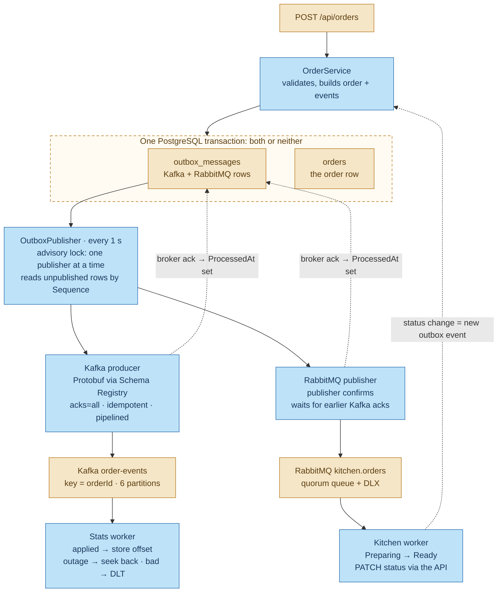
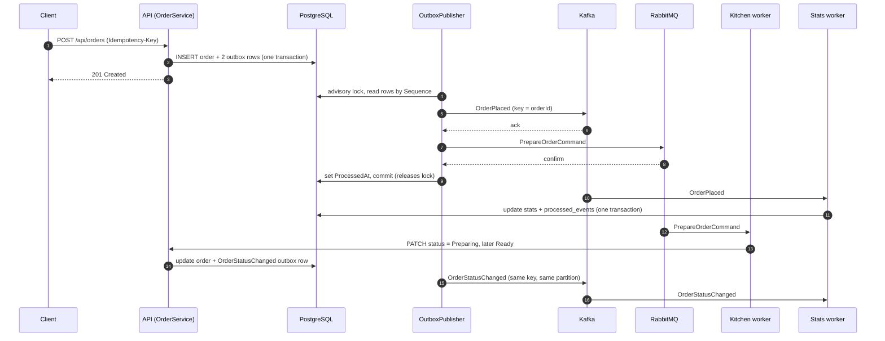

# Messaging workflow: API → outbox → producers → consumers

This document follows one order through BrewQueue's messaging: from the HTTP request, through the
transactional outbox, to the Kafka and RabbitMQ producers, and on to the two consumers. It explains
what each step guarantees, what happens when something fails, and where to find the code.

For how the Kafka cluster itself is secured and operated, see [kafka-production.md](kafka-production.md).

---

## The big picture



Sky blue = BrewQueue code. Beige = storage and brokers. Dotted lines = feedback.

---

## Step by step

### 1. The request is accepted, inside one transaction

`POST /api/orders` reaches `OrdersController`, protected by the Redis `Idempotency-Key` filter.
`OrderService.PlaceAsync` then:

1. Loads the menu items and validates the order.
2. Adds the `orders` row.
3. Adds two `outbox_messages` rows:
   - `PrepareOrderCommand`, destination RabbitMQ (for the kitchen)
   - `OrderPlaced`, destination Kafka (for the stats)
4. Calls `SaveChangesAsync` **once**, so all three rows commit together, or none do.

This is the **transactional outbox** pattern. It avoids the dual-write problem: there's never an
order without its messages, or a message for an order that was rolled back. The API never talks to
a broker while handling the request, so a broker outage can't fail a customer's order.

Each outbox row also gets:
- a **`Sequence`**: a PostgreSQL identity value assigned at insert time. Publishing follows this
  order, not `OccurredAt`, because clocks on different API instances disagree.
- the request's **`CorrelationId`**, which then travels as a message header to every consumer's logs.

### 2. One publisher reads the outbox in order

`OutboxPublisher` is a background service in the API. Every second it:

1. Opens a transaction and calls `pg_try_advisory_xact_lock(<constant>)`.
   - If another API instance holds the lock, this instance skips the cycle.
   - The lock is released automatically when the transaction ends, including when an instance
     crashes, so another instance takes over on its next cycle.
2. Reads up to 200 rows where `ProcessedAt IS NULL AND AbandonedAt IS NULL`, ordered by `Sequence`.
3. Hands each row to the right producer, in order (step 3).
4. Saves the updated rows and commits, which releases the lock.

**Why one publisher?** With several instances publishing different batches in parallel, one
instance could send `OrderStatusChanged` before another had sent that order's `OrderPlaced`. One
active publisher at a time keeps each order's events in the order they were written.

### 3. Producers send, and rows are marked only after the broker acknowledges

**Kafka rows:**
1. The JSON payload is mapped to the Protobuf contract (`order_event.proto`).
2. The Protobuf serializer frames it with the latest schema id from Schema Registry
   (`auto.register.schemas=false`, `use.latest.version=true`).
3. The message is queued with **key = order id**, so all events of one order go to the same
   partition, in order.
4. Messages are **pipelined**: several are queued before any is awaited. The idempotent producer
   (`acks=all`, `max.in.flight=5`) keeps them in order within each partition.

**RabbitMQ rows:** before publishing one, the publisher waits for every earlier Kafka message to be
acknowledged, which preserves the overall order. It then publishes with **publisher confirms**.

**Marking rows published:** a row gets `ProcessedAt` only if it **and every row before it in the
batch** were acknowledged. At the first failure, the publisher stops. That row and everything after
it are sent again on the next cycle, even rows Kafka had already accepted. This can create
duplicates, which consumers handle (step 5), but it never sends one order's events out of order.

### 4. The brokers hold the messages

| | Kafka `order-events` | RabbitMQ `kitchen.orders` |
|---|---|---|
| Model | Event log: facts, kept for 14 days, replayable | Work queue: jobs, deleted once acknowledged |
| Ordering | Per order (key → partition) | No global ordering across workers |
| Durability | Replication factor 3, `min.insync.replicas=2` | Durable quorum queue, persistent messages |
| Failures | Consumer sends to `order-events.dlt` | Rejected messages are dead-lettered to `kitchen.orders.dlq` |

### 5. Consumers process, and must be idempotent

Every step above delivers **at least once**, so a consumer can see the same message twice. Both
consumers make a duplicate harmless.

**Stats worker** (Kafka, consumer group `brewqueue-stats`):

| Situation | What happens |
|---|---|
| Event applied | Counts updated and event id recorded in `processed_events`, in one transaction; then the offset is stored and committed in the background |
| Duplicate event id | Skipped (`processed_events` already has it) |
| Undecodable, empty or invalid message | Copied to `order-events.dlt` with `dlt-*` diagnostic headers, then the offset moves on |
| Failure that looks temporary (database down, timeout, concurrency conflict) | 3 quick retries; then the worker rewinds to the same offset and backs off (1 s → 30 s). It never dead-letters because of an outage. |
| Failure that looks permanent (a bug, a constraint violation) | 3 retries, then the DLT |

**Kitchen worker** (RabbitMQ, competing consumers):
1. Receives `PrepareOrderCommand`.
2. Calls `PATCH /api/orders/{id}/status` → `Preparing`, waits (simulated preparation), then → `Ready`.
3. Acknowledges the message.
4. On failure:
   - temporary errors are re-published after a backoff with an incremented `x-retry-count` header (up to 3 retries)
   - permanent errors and poison messages are nacked to `kitchen.orders.dlq`

Setting a status the order already has is a no-op, so redelivery is harmless.

### 6. The feedback loop

The kitchen worker changes status **through the API**, not by writing to the database. Each status
change runs through `OrderService.ChangeStatusAsync`, which updates the order and writes an
`OrderStatusChanged` outbox row in one transaction, just like step 1. So:

```
PrepareOrderCommand (RabbitMQ) → kitchen → PATCH status → outbox → OrderStatusChanged (Kafka) → stats
```

Business rules (allowed status transitions, optimistic concurrency) and event publishing stay in
one place, whoever triggers the change: the kitchen, a barista, or a test.

---

## One order, end to end



---

## What can fail, and what happens

| Failure | Effect | Recovery |
|---|---|---|
| Kafka or RabbitMQ down | Orders are still accepted; outbox rows pile up | Publisher backs off (up to 30 s) and drains the backlog when the broker is back |
| Schema Registry down | If the API hasn't fetched the schema yet, Kafka rows can't be serialized and stay unpublished | Retried automatically; nothing is lost |
| API instance crashes mid-batch | Its transaction rolls back and the lock is released | Another instance re-sends the batch; consumers deduplicate |
| A row can never be published (bad payload, record too large) | Retried 3 times, then marked `AbandonedAt` so it can't block everything behind it | `/health/ready` reports Degraded; fix the cause and set `AbandonedAt` back to null |
| Database down while consuming | Stats worker rewinds and waits; lag grows | Resumes automatically; the `StatsConsumerStuck` alert fires meanwhile |
| Bad event on Kafka | Sent to `order-events.dlt`; the partition keeps moving | The `OrderEventsDeadLettered` alert fires; fix, then `infra/kafka/replay_dlt.py` |
| Stats worker crashes | Uncommitted offsets are redelivered | `processed_events` skips what was already applied |

**Known gap:** if the publishing instance loses its *database* connection mid-cycle while Kafka is
still reachable, a second instance can start publishing before the first notices. The two could
briefly overlap. Closing this completely needs Kafka transactions with a shared `transactional.id`
(zombie fencing) or change data capture (Debezium) reading the outbox from the write-ahead log.

---

## Where the code lives

| Step | File |
|---|---|
| Accept the request, write order + outbox | `src/BrewQueue.Api/Services/OrderService.cs` |
| Idempotency-Key handling | `src/BrewQueue.Api/CrossCutting/IdempotencyFilter.cs` |
| Outbox table, `Sequence`, `AbandonedAt` | `src/BrewQueue.Infrastructure/Persistence/Entities.cs`, `BrewQueueDbContext.cs` |
| Lock, ordered pipelined publishing, cleanup | `src/BrewQueue.Api/Services/OutboxPublisher.cs` |
| Kafka producer + Protobuf serialization | `src/BrewQueue.Infrastructure/Messaging/OrderEventPublisher.cs` |
| Event contract and mapping | `src/BrewQueue.Contracts/Protos/order_event.proto`, `OrderEventMapper.cs` |
| RabbitMQ topology and publisher | `src/BrewQueue.Infrastructure/Messaging/RabbitMq.cs` |
| Kitchen consumer | `src/BrewQueue.KitchenWorker/KitchenConsumer.cs` |
| Stats consume loop | `src/BrewQueue.StatsWorker/OrderEventsConsumer.cs` |
| Retry / dead-letter decisions | `src/BrewQueue.Infrastructure/Stats/OrderEventProcessor.cs` |
| Dead-letter publisher | `src/BrewQueue.Infrastructure/Messaging/DeadLetterPublisher.cs` |
| Idempotent projection | `src/BrewQueue.Infrastructure/Stats/OrderStatsProjector.cs` |

## Settings worth knowing

| Setting | Default | Meaning |
|---|---|---|
| `Outbox:PollInterval` | 1 s | How often the publisher checks for new rows |
| `Outbox:BatchSize` | 200 | Rows per publishing cycle |
| `Outbox:MaxBackoff` | 30 s | Longest wait between cycles while publishing keeps failing |
| `Outbox:MaxPermanentFailures` | 3 | Attempts before a permanently failing row is abandoned |
| `Outbox:Retention` | 3 days | Published rows older than this are deleted (hourly) |
| `Kafka:Processing:MaxAttempts` | 3 | In-place attempts per message in the stats worker |
| `Kafka:Processing:InitialRetryDelay` | 200 ms | First retry delay; doubles each attempt |
| `Stats:ProcessedEventRetention` | 30 days | How long event ids are kept for deduplication (must exceed the topic's 14-day retention) |

## Seeing it work

- **Logs (Seq, http://localhost:5341):** filter by `CorrelationId = '…'` to follow one order
  through the API, the outbox publisher and both workers.
- **Outbox state:** `SELECT "Sequence", "Type", "Destination", "ProcessedAt", "Attempts", "LastError" FROM outbox_messages ORDER BY "Sequence" DESC LIMIT 20;`
- **Kafka UI (http://localhost:8081):** `order-events` shows each order's events on one partition;
  the `brewqueue-stats` consumer group shows lag.
- **RabbitMQ (http://localhost:15672):** watch `kitchen.orders` move between Ready and Unacked.
- **Try a failure:** `docker compose stop kafka-1 kafka-2`, place a few orders (they're accepted),
  then start the brokers again and watch the outbox drain in order.
