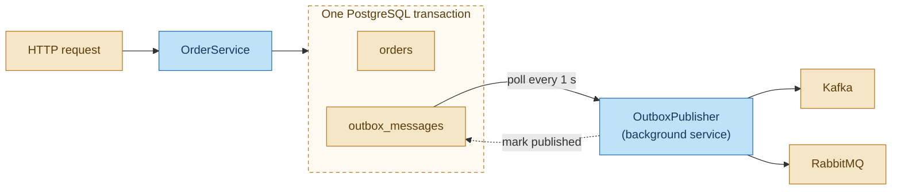
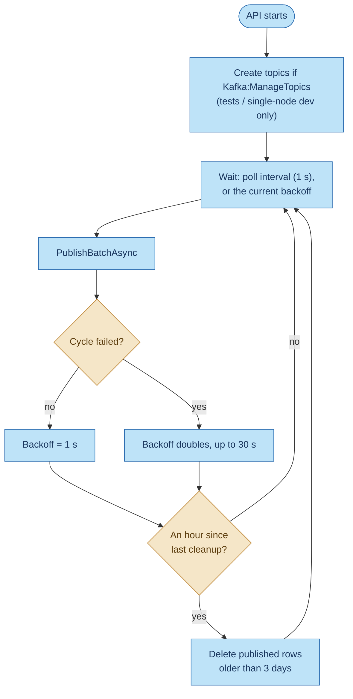
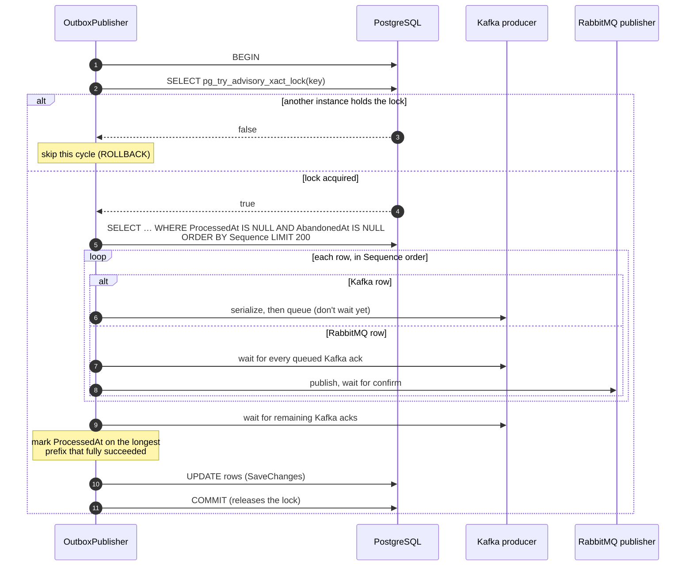

# The transactional outbox in BrewQueue

This document explains, in detail, how BrewQueue uses the **transactional outbox pattern** to get
messages from the API to Kafka and RabbitMQ reliably and in the right order:
- why the pattern is needed
- what the table looks like
- how rows are written and published
- how ordering is preserved across several API instances
- what happens on every kind of failure
- how to operate it

Related: [messaging-workflow.md](messaging-workflow.md) (the full API → broker → consumer path),
[schema-registry.md](schema-registry.md), [kafka-production.md](kafka-production.md).

---

## 1. The problem: dual writes

When an order is placed, two things must happen: the order is saved in PostgreSQL, **and**
messages go out (a command for the kitchen, an event for the stats). The obvious code does both
directly:

```csharp
await db.SaveChangesAsync();              // write 1: database
await kafka.ProduceAsync(orderPlaced);    // write 2: broker
```

A database and a broker can't share a transaction, so any failure between the two writes leaves
the system inconsistent:

| What fails | Result |
|---|---|
| Broker unreachable after the database commit | The order exists, but the kitchen and stats never hear about it |
| Process crashes between the two writes | Same: a silent, permanent gap |
| Publish first, then the database write fails | Consumers act on an order that doesn't exist |
| Broker slow or down | Placing an order is slow or fails, even though the database is fine |

## 2. The solution: write messages to the database first

The API doesn't talk to a broker while handling a request. It writes the order **and** the messages
it wants to send into PostgreSQL, **in the same transaction**. A separate background process then
reads those message rows and publishes them.



This turns two writes that can disagree into **one** atomic database write, plus a retry loop:
- Either the order and its messages are all committed, or none are.
- Once committed, a message is published eventually, however long the broker is down.
- Order placement depends only on PostgreSQL; broker outages never reach the customer.

The price: messages are delivered **at least once** (step 7 explains why), and arrive about a
second later than with a direct publish.

---

## 3. The `outbox_messages` table

Defined in `src/BrewQueue.Infrastructure/Persistence/Entities.cs` (`OutboxMessage`) and
`BrewQueueDbContext.cs`:

| Column | Type | Purpose |
|---|---|---|
| `Id` | uuid (v7) | Row id. Also used as the RabbitMQ `MessageId`. |
| `Sequence` | bigint, identity (`GENERATED ALWAYS`) | Assigned by PostgreSQL at insert. **The publishing order.** |
| `Destination` | text: `Kafka` / `RabbitMq` | Which broker gets it |
| `Type` | text | `PrepareOrderCommand`, `OrderPlaced`, `OrderStatusChanged` |
| `Key` | text | The order id. Kafka message key, so all of an order's events share a partition. |
| `Payload` | jsonb | The message body as JSON (converted to Protobuf at publish time for Kafka) |
| `CorrelationId` | text | The HTTP request's correlation id, sent on as a message header |
| `OccurredAt` | timestamptz | When the business change happened (informational) |
| `ProcessedAt` | timestamptz, null | Set when the broker acknowledged it. `null` = still to publish. |
| `Attempts` | int | Failed publish attempts so far |
| `LastError` | text | The latest failure message (truncated to 2000 characters) |
| `AbandonedAt` | timestamptz, null | Set when it failed permanently and was set aside (step 8) |

Indexes:
- `ix_outbox_messages_pending`: on `Sequence`, **partial**, `WHERE "ProcessedAt" IS NULL AND
  "AbandonedAt" IS NULL`. The publisher's query only ever touches this small index, however many
  old rows the table holds.
- `ix_outbox_messages_processed_at`: on `ProcessedAt`, used by the cleanup job.

**Why `Sequence` and not `OccurredAt`?** `OccurredAt` comes from the clock of whichever API instance
handled the request, and clocks on different machines drift. Ordering by it could put a status
change before the `OrderPlaced` it follows. `Sequence` comes from the database, so one counter
serves every instance.

---

## 4. Writing: what goes into the outbox

`src/BrewQueue.Api/Services/OrderService.cs` adds rows through one helper, `AddOutbox`, and commits
them with the business change in a single `SaveChangesAsync`:

```csharp
db.Orders.Add(order);
AddOutbox(OutboxDestination.RabbitMq, nameof(PrepareOrderCommand), order.Id, prepareCommand, now);
AddOutbox(OutboxDestination.Kafka,    OrderEventTypes.OrderPlaced,  order.Id, orderPlacedEvent, now);
await db.SaveChangesAsync(ct);   // one transaction: order + both outbox rows
```

| Operation | Business change | Outbox rows |
|---|---|---|
| `PlaceAsync` (POST /api/orders) | Insert `orders` + `order_lines` | `PrepareOrderCommand` → RabbitMQ, `OrderPlaced` → Kafka |
| `ChangeStatusAsync` (PATCH /api/orders/{id}/status) | Update `orders.Status` | `OrderStatusChanged` → Kafka |
| Status already as requested | Nothing | **None.** A repeated PATCH, such as a kitchen retry, doesn't produce duplicate events. |

Points worth noticing:
- Each event gets a fresh `EventId` **when the row is written**. If the row is published twice, both
  copies carry the same `EventId`, which is what lets consumers deduplicate (step 7).
- A concurrent update of the same order fails on the `xmin` concurrency token
  (`DbUpdateConcurrencyException` → 409). Its outbox row is rolled back with it, so no event is
  published for a change that didn't happen.

---

## 5. Publishing: the background loop

`src/BrewQueue.Api/Services/OutboxPublisher.cs` runs inside every API instance as a hosted service.



The backoff means a broker outage doesn't turn into a tight loop of failing requests; as soon as one
cycle succeeds, polling returns to every second.

### One cycle: `PublishBatchAsync`



---

## 6. Ordering, in detail

Getting one order's messages out **in the order they were written** takes four mechanisms working
together.

### 6.1 One publisher at a time: the advisory lock

Every cycle starts with `pg_try_advisory_xact_lock(0x4252455751554555)`. The constant is ASCII
"BREWQUEU", and any value works as long as every instance uses the same one.
- **Try:** if another instance holds the lock, the call returns `false` at once and this instance
  skips the cycle. It never waits.
- **Transaction-scoped:** the lock is released automatically at `COMMIT` or `ROLLBACK`, and also if
  the instance crashes or loses its connection. There's no lock to clean up and no leader to elect.

**Why it matters:** the earlier design used `FOR UPDATE SKIP LOCKED`, which let several instances
publish *different* batches at the same time. Instance B could send an order's
`OrderStatusChanged` while instance A was still sending its `OrderPlaced`. With the lock, batches
are published strictly one after another.

**Try it:** `docker compose up -d --scale api=3`. All three instances poll, but only one publishes
in any cycle.

### 6.2 Reading by `Sequence`

Within a cycle, rows are read in ascending `Sequence`. For one order, `Sequence` order always
matches the order its changes were committed:
- A status change needs the order row, which only exists once `PlaceAsync` has committed. So the
  status change's outbox row is inserted later and gets a higher `Sequence`.
- Two concurrent changes to the same order can't both commit, because the `xmin` token rejects one
  of them.

Across *different* orders, a row with a lower `Sequence` can occasionally commit just after the
publisher has read past it: transaction 1 took `Sequence` 100, transaction 2 took 101, and 2
committed first. Row 100 is then published in the next cycle, after 101. That's harmless, because
Kafka only promises order within a key (one order), never across keys.

### 6.3 Pipelined, but in order

Waiting for each Kafka acknowledgement before sending the next message would cost a network round
trip per message. Instead:
1. Each Kafka row is **serialized first** (Protobuf + schema id), then queued with `ProduceAsync`.
   With pre-serialized bytes, the Confluent client queues the message before the call returns, so
   **call order = queue order**.
2. The **idempotent producer** (`acks=all`, `max.in.flight=5`) keeps that order within each
   partition, even across internal retries.
3. Acknowledgements are collected afterwards, in order.

A **RabbitMQ row** first waits until every Kafka message queued before it is acknowledged, then
publishes with a confirm. That way the kitchen never gets ahead of the event stream.

### 6.4 The prefix rule: what gets marked published

A row is marked published only if it **and every row before it in the batch** succeeded. Example
batch for order A:

| Sequence | Message | Broker result | Marked `ProcessedAt`? |
|---|---|---|---|
| 41 | OrderPlaced (A) | acked | yes |
| 42 | PrepareOrderCommand (A) | confirmed | yes |
| 43 | OrderStatusChanged → Preparing (A) | **failed** (timeout) | no: `Attempts` + 1, `LastError` set |
| 44 | OrderStatusChanged → Ready (A) | acked | **no**, because 43 before it failed |

The next cycle starts again at 43, then re-sends 44. Kafka now holds 44 twice, and the stats
worker skips the second copy because its `EventId` is already recorded. The duplicate is harmless.
Publishing 44 *without* 43 first would have been the real problem.

---

## 7. Delivery guarantee: at least once

The outbox guarantees every committed message is published **at least once**. It can't guarantee
**exactly once**, because the broker acknowledgement and the database update are still two separate
systems:

| The process crashes… | What happened | On recovery |
|---|---|---|
| …before `COMMIT` of the business transaction | Nothing committed | Nothing to publish (the client sees an error and can retry with its Idempotency-Key) |
| …after `COMMIT`, before the publisher runs | Rows wait in the outbox | Published on the next cycle, by this or another instance |
| …during a publishing cycle, before its `COMMIT` | `ProcessedAt` is set in memory as acks arrive, but only saved by the batch's one `SaveChanges` + `COMMIT`. The transaction rolls back and the lock is released. Messages the broker already received stay there, and their rows stay unpublished. | The **whole batch** is re-sent by the next lock holder. Consumers see duplicates of every message the broker had already received. |

A failure that isn't a crash has the same effect on a smaller scale: if the broker accepted a message
but the publisher never saw the ack (a timeout or dropped connection), or an earlier row in the batch
failed (the prefix rule, step 6.4), that row stays unpublished and is sent again next cycle.

So **every consumer must be idempotent**, and in BrewQueue they are:
- **Stats worker:** records each `EventId` in `processed_events`, in the same transaction as the
  stats update, and skips ids it has already seen.
- **Kitchen worker:** a status change to the status the order already has is a no-op, and writes no
  new outbox row (step 4).

---

## 8. Failure handling

`RecordFailure` and `IsPermanent` in `OutboxPublisher.cs` sort failures into two kinds:

| Kind | Examples | Behaviour |
|---|---|---|
| **Transient**: will fix itself | Broker down, timeout, `NotEnoughReplicas`, Schema Registry unreachable | `Attempts` + 1, `LastError` saved, retried every cycle with backoff, **forever**. Nothing is ever lost because of an outage. |
| **Permanent**: retrying can't help | Payload isn't valid JSON (`JsonException`), unknown status (`ArgumentException`), invalid event, Kafka `MsgSizeTooLarge`, `InvalidMsg`, `InvalidRecord` | Retried up to `MaxPermanentFailures` (3), then **abandoned**: `AbandonedAt` is set and the row is skipped from then on |

**Why abandon at all?** Because of the prefix rule, one row that can never be published would block
every row behind it, forever. Abandoning it trades a little ordering (later events for *that one
order* go out without it) for keeping everything else moving. It's logged as **Critical**, and the
health check turns Degraded (step 10), so it doesn't go unnoticed.

**Retrying an abandoned row** after fixing the cause:

```sql
UPDATE outbox_messages SET "AbandonedAt" = NULL, "Attempts" = 0 WHERE "Id" = '<id>';
```

**Shutdown:** in-flight work is cancelled, the transaction rolls back, and rows stay unpublished for
the next instance. Nothing is half-marked.

---

## 9. Cleanup

Published rows aren't needed after a while. Once an hour, the lock holder's loop deletes rows whose
`ProcessedAt` is older than `Outbox:Retention` (3 days), 1,000 at a time so locks and write-ahead-log
bursts stay small:

```sql
DELETE FROM outbox_messages
WHERE "Id" IN (SELECT "Id" FROM outbox_messages WHERE "ProcessedAt" < @cutoff LIMIT 1000);
```

Unpublished and abandoned rows are never deleted.

---

## 10. Monitoring

**Health check** (`OutboxHealthCheck`, part of `GET /health/ready`):

| Condition | Status |
|---|---|
| Any abandoned row | **Degraded**: "N abandoned outbox message(s); see LastError in outbox_messages" |
| Oldest pending row waiting more than 2 minutes | **Degraded**: "Outbox message waiting for more than 2 minutes" |
| Otherwise | Healthy (reports `abandoned` and `oldestPendingSeconds`) |

**Logs** (Seq): `Failed to publish outbox message … will retry` (warning) and `Abandoned outbox
message …` (critical), each with the row's `CorrelationId`.

**Handy queries:**

```sql
-- What's waiting, oldest first
SELECT "Sequence", "Type", "Destination", "Attempts", "LastError", now() - "OccurredAt" AS age
FROM outbox_messages
WHERE "ProcessedAt" IS NULL AND "AbandonedAt" IS NULL
ORDER BY "Sequence" LIMIT 50;

-- Abandoned rows that need a human
SELECT "Id", "Sequence", "Type", "Attempts", "LastError", "AbandonedAt"
FROM outbox_messages WHERE "AbandonedAt" IS NOT NULL;

-- Is an instance publishing right now? (a row here means the lock is held)
SELECT pid, granted FROM pg_locks WHERE locktype = 'advisory';
```

---

## 11. Configuration

`appsettings.json` → `Outbox` (`OutboxOptions`):

| Setting | Default | Effect |
|---|---|---|
| `PollInterval` | `00:00:01` | Delay between cycles when everything is fine. Lower = less latency, more database queries. |
| `BatchSize` | `200` | Rows per cycle |
| `MaxBackoff` | `00:00:30` | Longest delay between cycles while publishing keeps failing |
| `MaxPermanentFailures` | `3` | Attempts before a permanently failing row is abandoned |
| `Retention` | `3.00:00:00` | How long published rows are kept before cleanup |

Related producer settings (`KafkaClientConfig.DurableProducer`): `acks=all`, idempotence on,
`max.in.flight=5`, zstd compression, `linger.ms=10`, and `message.timeout.ms=120000`. After that
timeout a message counts as failed and is retried by the outbox.

---

## 12. How it's tested

Integration tests live in `tests/BrewQueue.IntegrationTests/` and run against Testcontainers.

| Test | What it proves |
|---|---|
| `OutboxPublisherTests.Only_the_instance_holding_the_lock_publishes` (integration) | While "another instance" holds the advisory lock, nothing is published; once it's released, publishing resumes |
| `OutboxPublisherTests.Messages_are_published_in_sequence_order` (integration) | One order's 5 messages (1 RabbitMQ + 4 Kafka) are all published, in `Sequence` order |
| `MessagingTests.Placing_an_order_puts_a_PrepareOrder_command_on_the_kitchen_queue` (integration) | A RabbitMQ outbox row reaches the real kitchen queue |
| `MessagingTests.Status_changes_are_published_to_Kafka_as_schema_registry_framed_protobuf` (integration) | A Kafka outbox row reaches the real topic as Protobuf with the registered schema id |
| `OutboxPublisherTests.Classifies_failures` (unit, `tests/BrewQueue.UnitTests/Api/`) | Which errors abandon a row and which are retried forever |

---

## 13. Limitations and alternatives

- **A brief overlap is possible in one edge case.** If the publishing instance loses its *database*
  connection mid-cycle while Kafka is still reachable, PostgreSQL releases the lock, and a second
  instance can start publishing before the first notices. Ways to close this completely:
  - **Kafka transactions** with a shared `transactional.id`: a new producer fences off the old
    ("zombie") one, so the old one's late sends are rejected.
  - **Change data capture (Debezium):** a connector reads committed outbox rows from PostgreSQL's
    write-ahead log, in commit order, with no polling and no lock.
- **Polling costs a query per second per instance.** That's cheap with the partial index. At high
  volume, CDC or `LISTEN/NOTIFY` wake-ups are the usual next step.
- **Latency:** messages leave up to about one poll interval after commit. That's fine for kitchen
  tickets and stats; tune `PollInterval` if you need less.
- **Schema changes:** the app creates tables with `EnsureCreated`, which doesn't alter existing
  ones. Switch to EF Core migrations before changing this table in a long-lived database.

---

## Where the code lives

| What | File |
|---|---|
| Table definition, `Sequence`, `AbandonedAt`, indexes | `src/BrewQueue.Infrastructure/Persistence/Entities.cs`, `BrewQueueDbContext.cs` |
| Writing rows with the business change | `src/BrewQueue.Api/Services/OrderService.cs` (`AddOutbox`) |
| Loop, lock, ordered publishing, failures, cleanup | `src/BrewQueue.Api/Services/OutboxPublisher.cs` |
| Kafka publishing (serialize, then queue) | `src/BrewQueue.Infrastructure/Messaging/OrderEventPublisher.cs` |
| RabbitMQ publishing (confirms) | `src/BrewQueue.Infrastructure/Messaging/RabbitMq.cs` |
| Producer durability settings | `src/BrewQueue.Infrastructure/Messaging/Kafka.cs` (`DurableProducer`) |
| Health check | `src/BrewQueue.Api/CrossCutting/HealthChecks.cs` (`OutboxHealthCheck`) |
| Settings | `src/BrewQueue.Api/appsettings.json` → `Outbox` |
