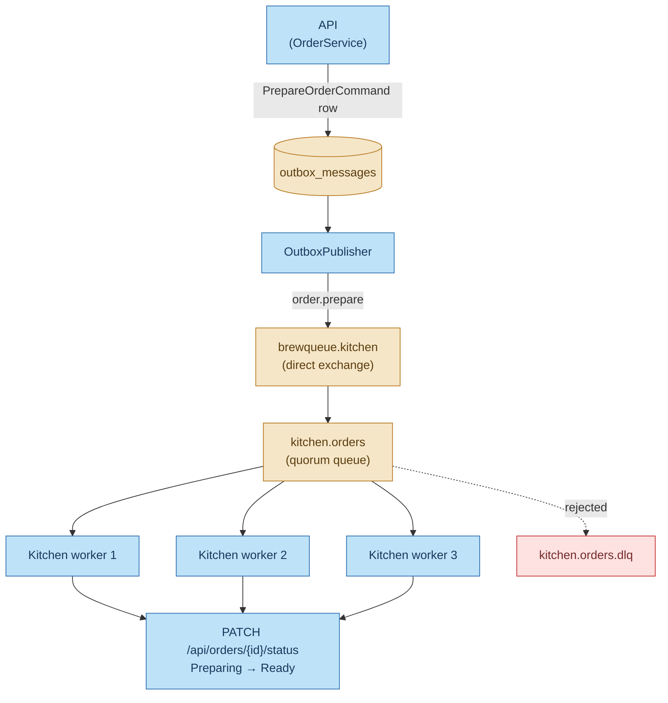
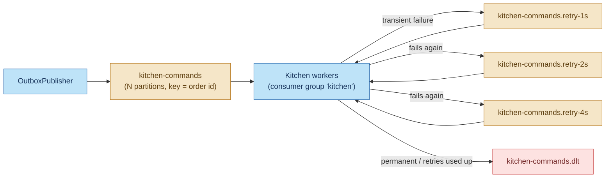
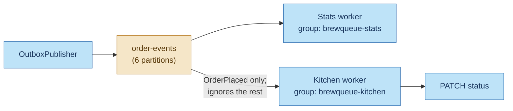

# RabbitMQ in BrewQueue, and whether Kafka could replace it

BrewQueue runs **two** message brokers:
- **RabbitMQ** carries one thing: the kitchen's "please prepare this order" command.
- **Kafka** carries the stream of order events that the stats worker reads.

This document explains:
- what RabbitMQ does here
- why a queue suits that job
- what changes if Kafka takes it over, in three possible designs
- which of those designs is worth considering

**Short answer:** yes, Kafka *can* replace RabbitMQ here, and the cleanest way is to let the kitchen
consume the `OrderPlaced` event directly. But you'd have to rebuild retries, delays and
dead-lettering by hand, and accept per-partition blocking. Kafka's own queue feature (share groups)
would remove most of that, but it isn't usable from this project's stack yet.

Related: [messaging-workflow.md](messaging-workflow.md), [dead-letter-queues.md](dead-letter-queues.md),
[idempotency.md](idempotency.md), [kafka-production.md](kafka-production.md).

---

## 1. What RabbitMQ does in this project

When an order is placed:
1. `OrderService.PlaceAsync` writes a `PrepareOrderCommand` outbox row, in the same transaction as
   the order.
2. The `OutboxPublisher` publishes it to the `brewqueue.kitchen` exchange with a publisher confirm.
   The message id is the outbox row id.
3. The exchange routes it to the `kitchen.orders` queue.
4. **One** kitchen worker receives it. It sets the order to `Preparing`, simulates preparation
   (`Kitchen:PrepareTime`, 8 s), sets it to `Ready`, then **acks**. The ack deletes the message
   from the queue.

The kitchen worker's settings (`KitchenConsumer.cs`, `RabbitMqOptions`):

| Setting | Value | Effect |
|---|---|---|
| `autoAck` | `false` | A message is removed only after the work is done. If the worker dies, RabbitMQ gives it to another worker. |
| `PrefetchCount` | 5 | Each worker holds at most 5 unacked orders. RabbitMQ sends the rest to workers with free capacity. |
| `ConsumerDispatchConcurrency` | 4 | Each worker prepares up to 4 orders in parallel |
| Queue type | quorum | Replicated and durable; dead-letters after 20 redeliveries |
| Retries | re-publish with `x-retry-count`, 1 s / 2 s / 4 s | Transient failures retry without blocking anything else |
| Dead letters | `x-dead-letter-exchange` → `kitchen.orders.dlq` | The broker moves rejected messages itself |

To scale it, run `docker compose up -d --scale kitchen=3`. RabbitMQ spreads orders across all
workers, with no setup and no upper limit.

---

## 2. Commands vs events: why two brokers

The two brokers carry two different *kinds* of message:

| | `PrepareOrderCommand` (RabbitMQ) | `OrderPlaced`, `OrderStatusChanged` (Kafka) |
|---|---|---|
| Kind | **Command**: "do this job" | **Event**: "this happened" |
| Who handles it | Exactly **one** kitchen worker | **Every** interested service (today: stats; tomorrow: maybe notifications, analytics…) |
| After handling | Gone: a done job has no further use | Kept for 14 days: new consumers can read history, and anyone can replay |
| Work per message | Slow (seconds), and the worker holds it the whole time | Fast (one database transaction) |
| Ordering needed? | No: each order is independent | Yes, per order (placed before preparing before ready) |
| Failure unit | One job | One position in a log |

**RabbitMQ is a smart broker built around the individual message.** It tracks every message's state
(ready, delivered, acked), redelivers on its own, and dead-letters by itself.
**Kafka is a log built around position.** Consumers track only *how far* they've read in each
partition. It's very fast and keeps history, but it knows nothing about individual messages.

A kitchen ticket is the textbook case for a queue; a stream of facts for analytics is the textbook
case for a log. That's the reasoning behind the split. It's also a deliberate learning choice: the
project lets you use both.

---

## 3. What the kitchen gets from RabbitMQ that Kafka doesn't give for free

| Need | RabbitMQ (today) | Kafka consumer group |
|---|---|---|
| **Acknowledge one message** | `BasicAck` on that delivery tag | Commit an **offset**, meaning "everything before here is done". You can't ack #7 while #5 is still in progress. |
| **Scale workers** | Any number. Messages go to whoever has a free prefetch slot. | At most **one worker per partition**; extra workers sit idle |
| **A slow job** | Only occupies the worker that has it | **Blocks every later message in its partition** (head-of-line blocking) |
| **Retry one message later** | Re-publish with a counter (or a TTL queue); other messages carry on | No per-message retry. Either block the partition, or build retry topics yourself. |
| **Dead-lettering** | Built in: `x-dead-letter-exchange` | Build it yourself (as the stats worker does with `order-events.dlt`) |
| **Crash-loop protection** | Quorum queue delivery limit (20) | Build it yourself |
| **Worker dies mid-job** | That one message is redelivered to someone else | Its partitions are rebalanced; everything after the last committed offset is redelivered |
| **Work that takes a while** | Fine: no limit while the connection is alive | Must keep calling `Consume()` within `max.poll.interval.ms`, or the worker is kicked out of the group |
| **Remove finished work** | Ack deletes it | Stays until retention expires |

The second, third and fourth rows matter most for a kitchen. **Head-of-line blocking** in particular:
with Kafka, if one partition receives orders A, B and C, B can't start until A is done, even if
other workers are idle.

---

## 4. Can Kafka replace it? Three designs

### Design A: a `kitchen-commands` topic

Keep the command, and move it from RabbitMQ to a Kafka topic.

What you'd have to build:
- **Retry topics.** Each delay level needs its own topic and consumer, and that consumer has to wait
  until a message's due time before handing it back. This is the "non-blocking retries" pattern
  (Spring Kafka and Uber both describe versions of it). It replaces RabbitMQ's simple re-publish.
- **A dead-letter topic and replay tooling**: reuse the stats worker's `KafkaDeadLetterPublisher`
  and `replay_dlt.py` pattern.
- **Enough partitions.** With 8 s jobs, maximum parallelism equals the partition count, so choose it
  for peak load. Partitions can't be removed later, and adding them remaps keys.
- **A plan for head-of-line blocking.** Either accept it, or process several records of a partition
  concurrently and only commit the lowest finished offset. Confluent's Parallel Consumer does this,
  but it's Java-only.

You gain little in return: a command has no history worth keeping, and nobody else reads it.
**This is the weakest option.**

### Design B: drop the command, and let the kitchen read the event

The command only exists to tell the kitchen an order was placed, but `OrderPlaced` already says
that. The kitchen can become a **second consumer group** on `order-events`:

This is event-driven *choreography*: the API announces facts, and each service decides what to do
with them.

| Pros | Cons |
|---|---|
| RabbitMQ disappears: one fewer broker to run, secure and monitor | Every limitation in section 3 applies: parallelism capped at 6, head-of-line blocking, home-made retries and dead-lettering |
| `PlaceAsync` writes one outbox row instead of two | The kitchen reads every event and discards the status changes it causes itself |
| A new consumer can be added with no change to the API | `OrderEvent` becomes the kitchen's contract too, so schema changes have one more reader to protect |
| The kitchen can replay history (e.g. rebuild a ticket board) | The kitchen needs ACLs on `order-events` and a Schema Registry deserializer |
| Per-order ordering comes for free | A kitchen outage shows up as consumer lag, not as a queue depth |

The head-of-line problem is mostly an artifact of the simulation. The worker *holds* the message for
8 seconds because it fakes cooking with `Task.Delay`. In a real café, a person presses "Ready" in a
kitchen UI. The worker would then only need to set `Preparing` (milliseconds) and commit, and
blocking would stop mattering. **If you consolidate on Kafka, this is the design to choose**,
combined with that change.

### Design C: Kafka share groups ("Queues for Kafka")

[KIP-932](https://cwiki.apache.org/confluence/display/KAFKA/KIP-932%3A+Queues+for+Kafka) adds
**share groups** to Kafka. Consumers in a share group get queue behaviour on an ordinary topic:
- records are handed out individually, so consumers can outnumber partitions
- each record is acknowledged, released or rejected on its own
- the broker counts deliveries per record and stops redelivering after a limit
- a lock times out if a consumer dies

That covers most of section 3's table, and makes Kafka a genuine queue.

Where it stands as of October 2026:

| Component | Status |
|---|---|
| Apache Kafka broker | Share groups are **production-ready since Kafka 4.2.0** (early access in 4.0, preview in 4.1). 4.2 also added a `RENEW` acknowledgement to extend a lock for long-running work. |
| This project's brokers | **Kafka 4.0.0**: only early access here, so an upgrade would be needed first |
| librdkafka (used by the .NET client) | Share consumer in **preview** (v2.15), marked as not for production |
| Confluent .NET client | No production-ready share consumer yet |
| Dead-letter queue for share groups | Not part of 4.2: rejected records are archived, not moved to a topic |

**Revisit this once the .NET client's share consumer is GA.** Then Design B with a share group gives
the kitchen queue semantics and history, with no second broker. Until then it isn't an option for
BrewQueue.

---

## 5. What a migration to Design B would touch

| Area | Change |
|---|---|
| `OrderService.PlaceAsync` | Stop writing the `PrepareOrderCommand` outbox row |
| `OutboxPublisher` | Remove the RabbitMQ branch and the drain before it |
| `KitchenConsumer` | Rewrite as a Kafka consume loop: group `brewqueue-kitchen`, Protobuf deserializer, handle only `OrderPlaced`, store offsets after the work. Reuse `OrderEventProcessor`'s retry and dead-letter logic. |
| Kitchen settings | Kafka bootstrap servers, TLS, SCRAM user, Schema Registry |
| `infra/kafka/setup-kafka.sh` | A `kitchen` user; read on `order-events`, group `brewqueue-kitchen`, write on a `kitchen` dead-letter topic |
| Monitoring | Lag and stuck alerts for `brewqueue-kitchen` (copy the stats rules) |
| `docker-compose.yml`, health checks | Remove `rabbitmq` and the RabbitMQ health check |
| Tests | Replace the RabbitMQ integration tests; drop the RabbitMQ Testcontainer |
| Contracts | `PrepareOrderCommand` and the RabbitMQ names in `MessagingNames` can go |

Idempotency carries over unchanged: Kafka also redelivers, and the kitchen's status changes are
already safe to repeat (see [idempotency.md](idempotency.md), step 4.4).

---

## 6. Recommendation

| Situation | Choice |
|---|---|
| **This project** | **Keep RabbitMQ.** The split shows commands vs events, queue vs log, broker-side vs consumer-side dead-lettering. |
| A small production system that wants one fewer broker | **Design B**, with the kitchen made non-blocking (a person or a timer sets `Ready`, and the worker doesn't hold the message) |
| Lots of slow, independent jobs (image processing, emails, payments) | **A real queue**: RabbitMQ, or a cloud queue (SQS, Azure Service Bus) |
| Already all-in on Kafka, on Kafka 4.2+ with a client that supports share groups | **Design C** |
| Any case | **Not Design A.** It carries all of Kafka's queue costs, without the history and fan-out benefits of Design B. |

The decision rarely comes down to features alone. The usual deciding factor is **operational cost**:
each broker needs TLS, credentials, monitoring, upgrades, backups, and someone who knows how it
fails. Running both is worth it when you need both models heavily. When one of them carries a
single message type, consolidating is a reasonable trade.

---

## Sources

- [Apache Kafka 4.2.0 release announcement](https://kafka.apache.org/blog/2026/02/17/apache-kafka-4.2.0-release-announcement/): share groups production-ready, KIP-1222 `RENEW` acknowledgement
- [KIP-932: Queues for Kafka](https://cwiki.apache.org/confluence/display/KAFKA/KIP-932%3A+Queues+for+Kafka)
- [librdkafka v2.15.0 release notes](https://newreleases.io/project/github/confluentinc/librdkafka/release/v2.15.0): share consumer in preview
- [Karafka: Consumer groups vs share groups](https://karafka.io/docs/Basics-Consumer-Groups-vs-Share-Groups/)
- [RabbitMQ: Quorum queues](https://www.rabbitmq.com/docs/quorum-queues) (delivery limit, dead-lettering)
