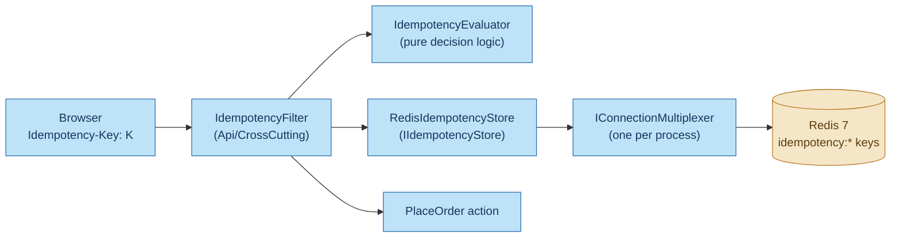
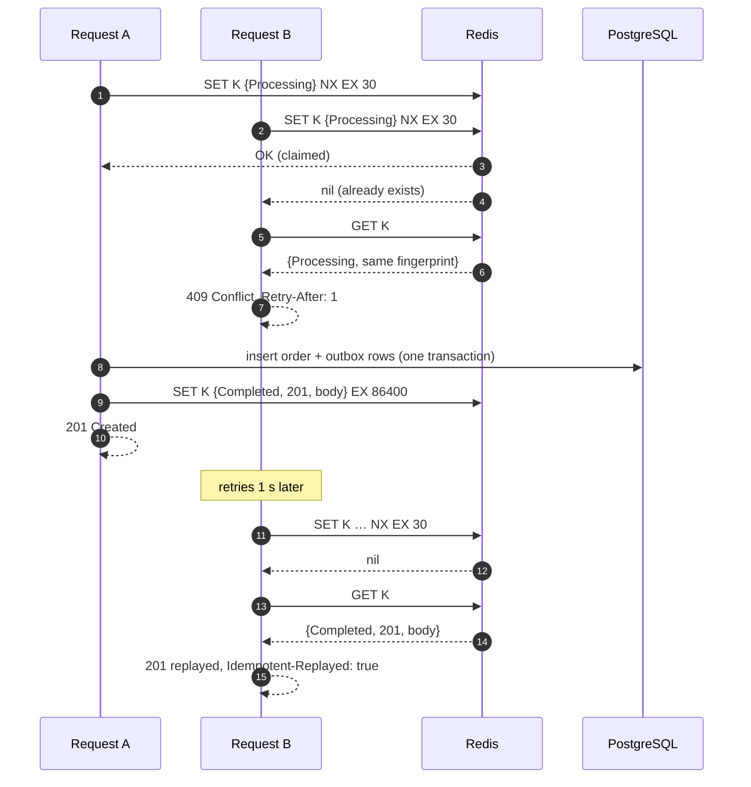

# Redis for idempotency in BrewQueue

BrewQueue uses Redis for exactly one job: remembering **`Idempotency-Key`s** for
`POST /api/orders`, so a repeated checkout request doesn't create a second order. This document
covers the Redis side in detail:
- why Redis
- the exact commands
- how keys and values are laid out
- how races are handled
- what happens when Redis misbehaves
- what to change before running it for real

For the end-to-end picture (the browser's key, the status endpoint, Kafka and the stats worker),
see [idempotency.md](idempotency.md).

---

## 1. Why Redis

The idempotency filter needs a store that can:

| Need | How Redis meets it |
|---|---|
| **Claim a key atomically**: of two simultaneous requests with the same key, exactly one may proceed | `SET key value NX`: one command, and Redis runs commands one at a time |
| **Forget keys automatically** | A TTL on every key (`EX`): no cleanup job |
| **Be fast**, since it's on the hot path of every checkout | In-memory, typically well under a millisecond per command |
| **Be shared by every API instance** | One Redis that all instances talk to |
| **Stay out of the business data** | A separate store, with nothing added to the order tables |

PostgreSQL could do all of this too, with an `idempotency_keys` table, a unique key and a cleanup
job. Section 7 explains why that's actually the stronger design. Redis was chosen here because it
makes the mechanism easy to see in isolation, and because learning Redis was one of the project's
goals.

---

## 2. The pieces



| Piece | File | Role |
|---|---|---|
| `IIdempotencyStore` | `src/BrewQueue.Infrastructure/Idempotency/Idempotency.cs` | Three operations: `TryClaimAsync`, `CompleteAsync`, `ReleaseAsync` |
| `RedisIdempotencyStore` | same | The Redis implementation of those three |
| `IdempotencyEvaluator` | same | Turns "what's stored" + "this request" into a decision. No Redis in it, so it's unit-tested on its own. |
| `IdempotencyOptions` | same | `LockTtl` (30 s), `ResponseTtl` (24 h) |
| `IdempotencyFilter` + `[Idempotent]` | `src/BrewQueue.Api/CrossCutting/IdempotencyFilter.cs` | Runs around the action: claim → decide → run → complete or release |
| `AddRedisIdempotency` | `src/BrewQueue.Infrastructure/DependencyInjection.cs` | Registers the connection and the store |
| `RedisHealthCheck` | `src/BrewQueue.Api/CrossCutting/HealthChecks.cs` | `PING` as part of `/health/ready` |

### The connection

```csharp
services.AddSingleton<IConnectionMultiplexer>(_ =>
    ConnectionMultiplexer.Connect($"{redis},abortConnect=false"));
```

- **One multiplexer per process**, registered as a singleton. StackExchange.Redis is built to share
  one connection between all threads and requests. Opening a connection per request is the classic
  performance mistake with this library.
- **`abortConnect=false`**: if Redis isn't up when the API starts, the API still starts and the
  library keeps reconnecting in the background. Requests fail until Redis is back, and the health
  check reports it.
- Connection strings: `localhost:6379` in `appsettings.json`, `redis:6379` in Docker Compose, and
  the container's address in the integration tests (Testcontainers `redis:7-alpine`).

---

## 3. What's stored

### The key

```
idempotency:POST:/api/orders:3f0c9a8e-5b1d-4e8a-9c41-6f2b7d0e1a55
└─prefix──┘ └method┘└──path───┘ └──────the client's Idempotency-Key──────┘
```

- The **`idempotency:` prefix** keeps these keys apart from anything else that might share the
  Redis, and makes them easy to find (`SCAN … MATCH idempotency:*`).
- **Method and path** scope the key to one endpoint. The same UUID sent to two different endpoints
  is two different operations.
- The client's key must be a **UUID**: anything else is rejected with `400` before Redis is touched.
  So clients can't fill Redis with arbitrary strings.

### The value

A JSON-serialized `IdempotencyRecord`. While the request is running:

```json
{ "state": "Processing", "fingerprint": "9F86D081884C7D65…" }
```

After it succeeds:

```json
{
  "state": "Completed",
  "fingerprint": "9F86D081884C7D65…",
  "statusCode": 201,
  "responseBody": "{\"id\":\"0193…\",\"customerName\":\"Ana\",\"status\":\"Received\",…}",
  "location": "/api/orders/0193…"
}
```

| Field | Purpose |
|---|---|
| `state` | `Processing`: some request owns the key right now. `Completed`: the response is stored. |
| `fingerprint` | SHA-256 (hex) of the request's bound arguments. Used to catch the same key being reused with a **different** body. |
| `statusCode`, `responseBody`, `location` | Enough to replay the original response byte for byte |

A plain string holding JSON was chosen over a Redis **hash**: the record is always read and written
whole, and one `SET` can write the value **and** its TTL atomically. With a hash, `HSET` and
`EXPIRE` are two separate commands, so a crash in between would leave a key that never expires.

**Size:** roughly 100 bytes for the key and metadata, plus the order JSON (a few hundred bytes to
1–2 KB). Each key lives 24 hours, so 10,000 orders a day is about 10–20 MB of memory.

---

## 4. The commands, step by step

`RedisIdempotencyStore` uses four Redis commands:

| Store method | Redis command | When |
|---|---|---|
| `TryClaimAsync` | `SET key {Processing} NX EX 30` | Every request, first thing |
| `TryClaimAsync` (claim failed) | `GET key` | The key already existed: read what's there |
| `CompleteAsync` | `SET key {Completed…} EX 86400` | The action returned `2xx` |
| `ReleaseAsync` | `DEL key` | The action failed or returned a non-`2xx` result |

### 4.1 Claim: `SET … NX EX`

```csharp
var claimed = await db.StringSetAsync(
    Key(key), JsonSerializer.Serialize(processing, Json), _options.LockTtl, When.NotExists);
```

That's a single Redis command:

```
SET idempotency:POST:/api/orders:K '{"state":"Processing","fingerprint":"…"}' NX EX 30
```

- **`NX`**: only set it if the key doesn't exist. Redis replies `OK` (we claimed it) or `nil`
  (someone else already has it).
- **`EX 30`**: expire in 30 seconds. This is the crash safety net: if the API dies mid-request, the
  claim frees itself instead of blocking that checkout for a day.
- **Atomic:** checking for the key and setting it happen in one step. The alternative, `GET` and
  then `SET` if it's missing, lets two requests both see "missing" between the two commands. Then
  both would create an order.

### 4.2 Read what's there: `GET`

Only when the claim fails:

```csharp
var existing = await db.StringGetAsync(Key(key));
return existing.HasValue
    ? JsonSerializer.Deserialize<IdempotencyRecord>(existing.ToString(), Json)
    : processing;   // expired in between: treat as "in progress"
```

There's a tiny gap between the failed `SET NX` and this `GET`: the key could expire in between. In
that case the store reports `Processing`, and the client gets `409` and retries a second later.
That's the safe answer: refusing for one second beats risking a second order.

### 4.3 Complete: `SET … EX` (overwrite)

```csharp
redis.GetDatabase().StringSetAsync(Key(key), JsonSerializer.Serialize(record, Json), _options.ResponseTtl);
```

```
SET idempotency:POST:/api/orders:K '{"state":"Completed",…}' EX 86400
```

No `NX` this time, so it **overwrites** the `Processing` value. "If key already holds a value, it is
overwritten, regardless of its type" is exactly what's wanted: this request owns the key. The TTL
is also replaced, from 30 seconds to 24 hours.

### 4.4 Release: `DEL`

```
DEL idempotency:POST:/api/orders:K
```

When the action fails (validation error, menu item unavailable, an exception), the key is deleted
so the client can retry **with the same key**. Failures are never cached.

`CompleteAsync` and `ReleaseAsync` are called with `CancellationToken.None`: if the browser
disconnects after the order was created, the response is still stored for its retry.

---

## 5. How races play out

Five identical requests arrive at once. The integration test
`Concurrent_requests_with_the_same_key_create_exactly_one_order` does exactly this.



Redis runs commands one at a time, so two `SET NX` commands can't both succeed, even if they
arrive in the same microsecond. Every outcome:

| What the second request finds | Same body? | Response |
|---|---|---|
| Nothing (claims it) | — | Runs normally |
| `Processing` | yes | `409`, `Retry-After: 1`, `errorCode: idempotency_in_progress` |
| `Completed` | yes | The stored `201` and body, with `Idempotent-Replayed: true` |
| Either state | **no** | `422`, `errorCode: idempotency_key_reused` |

---

## 6. When Redis misbehaves

| Situation | What happens | Why |
|---|---|---|
| **Redis down** | `POST /api/orders` returns `500`. `/health/ready` reports Redis unhealthy. Other endpoints keep working. | **Fails closed**: without the idempotency check the API can't promise "no duplicate orders", so it refuses rather than guesses |
| **Redis slow** | Checkout is slow by the same amount | Every checkout makes 2–3 Redis round trips |
| **API crashes mid-request** | The `Processing` key expires after 30 s, then the client's retry runs normally | `EX 30` on the claim |
| **Redis restarts** | Depends on persistence: see below | — |
| **Order committed, then `CompleteAsync` fails** | The client gets `500`. The key stays `Processing` until it expires. **A retry after 30 s creates a second order.** | Redis and PostgreSQL can't share a transaction: the main weakness of this design |
| **A request takes longer than 30 s** | Its claim expires mid-request, so a retry can claim the key and run in parallel. **Two orders.** | The lock TTL is shorter than the request |
| **Slow request's `DEL` after its claim expired** | It deletes the **other** request's fresh claim, so a third request could also run | `DEL` doesn't check who owns the key (see 7.3) |

### Persistence in the Docker setup

`docker-compose.yml` runs `redis:7-alpine` with no config file and no named volume. Out of the box,
that means:
- Redis takes **RDB snapshots** to `/data` on its built-in schedule. That's after 1 hour if one key
  changed, 5 minutes if 100 did, or 1 minute if 10,000 did. Up to that much recent data is lost if
  Redis is killed.
- The official image declares `/data` as a volume, so Compose gives it an **anonymous** volume. It
  survives `docker compose restart`, but **`docker compose down` followed by `up` starts with an
  empty Redis.**

For local learning that's fine: losing the keys only means a retry within 24 hours isn't recognised.
For production, see section 7.

---

## 7. Before running it for real

### 7.1 Redis settings

| Setting | Recommendation | Why |
|---|---|---|
| **Persistence** | `appendonly yes`, `appendfsync everysec`, on a **named volume** (or a managed Redis with persistence) | At most about 1 s of keys lost on a crash, instead of minutes |
| **`maxmemory-policy`** | `noeviction` (the default), or a Redis instance used **only** for idempotency | Under memory pressure, `allkeys-lru` or `volatile-*` policies would **evict idempotency keys early**, silently turning retries into duplicate orders. With `noeviction`, writes fail loudly instead. |
| **`maxmemory`** | Set it, and alert on usage | Memory is the only thing that can run out |
| **Authentication** | `requirepass` or ACL users, and TLS (`ssl=true` in the connection string) | The Compose setup has neither: it's open on port 6379 |
| **High availability** | Replica + Sentinel, or a managed service | One Redis is a single point of failure for checkout |

**A caution about replication:** Redis replicates asynchronously. If the primary fails right after
acknowledging a `SET NX`, the promoted replica may never have seen it, so a retry can claim the key
again. `WAIT 1 100` after the claim narrows this window, at the cost of latency. It's another reason
for 7.2.

### 7.2 The stronger design: keep the record in PostgreSQL

Most of the problems in section 6 exist because the idempotency record and the order live in
**different systems**. The robust fix moves the record into PostgreSQL, **inside the same
transaction** as the order:

```sql
CREATE TABLE idempotency_keys (
    scope         text        NOT NULL,     -- 'POST:/api/orders'
    key           uuid        NOT NULL,
    fingerprint   text        NOT NULL,
    status_code   int,
    response_body jsonb,
    created_at    timestamptz NOT NULL DEFAULT now(),
    PRIMARY KEY (scope, key)
);
```

- `INSERT … ON CONFLICT DO NOTHING` claims the key. Inserting the order, the outbox rows and the
  stored response all commit **together**, or not at all.
- A crash can never leave "order created but no record", or "record but no order".
- No lock TTL, and no expiry race: an uncommitted claim simply blocks the second insert until the
  first transaction ends.
- A cleanup job deletes rows older than 24 hours, like the outbox and `processed_events` cleanups.

Redis can stay in front as an optional fast path for replays, or be removed entirely. This is the
design in Brandur Leach's widely cited *Implementing Stripe-like Idempotency Keys in Postgres*.

### 7.3 Smaller fixes if you keep Redis

- **Make the claim one round trip:** Redis 7 accepts `SET key value NX GET`. It claims the key if
  it's free, or returns the existing value if not, in one atomic command. That removes the
  expired-in-between gap in 4.2. In StackExchange.Redis this is
  `StringSetAndGetAsync(key, value, expiry, When.NotExists)`: it returns null if the claim
  succeeded, otherwise the existing value.
- **Release only your own claim:** store a random token in the `Processing` record, and delete with
  a small Lua script ("delete if the token matches"). Then a slow request can't delete another
  request's claim.
- **Size `LockTtl` from real data:** set it well above the API's request timeout (for example,
  2–3× the 99th percentile latency of `POST /api/orders`).

---

## 8. Inspecting it

```bash
# All idempotency keys (SCAN, not KEYS, so Redis isn't blocked on a big keyspace)
docker compose exec redis redis-cli --scan --pattern 'idempotency:*'

# One record, and how long it has left
docker compose exec redis redis-cli GET 'idempotency:POST:/api/orders:<uuid>'
docker compose exec redis redis-cli TTL 'idempotency:POST:/api/orders:<uuid>'

# Watch the commands live while you place an order (development only: MONITOR is expensive)
docker compose exec redis redis-cli MONITOR

# Memory used, and what happens when it runs out
docker compose exec redis redis-cli INFO memory | grep -E 'used_memory_human|maxmemory_policy'
```

With `MONITOR` running, one checkout shows:

```
"SET" "idempotency:POST:/api/orders:…" "{\"state\":\"Processing\",…}" "EX" "30" "NX"
"SET" "idempotency:POST:/api/orders:…" "{\"state\":\"Completed\",…}" "EX" "86400"
```

Then the same request again shows:

```
"SET" "idempotency:POST:/api/orders:…" "{\"state\":\"Processing\",…}" "EX" "30" "NX"
"GET" "idempotency:POST:/api/orders:…"
```

---

## 9. How it's tested

| Test | Uses Redis? | What it proves |
|---|---|---|
| `IdempotencyEvaluatorTests` (unit) | No | The four decisions: proceed, replay, in progress, mismatch |
| `OrdersApiTests.Same_idempotency_key_returns_the_original_response_and_creates_one_order` | Real Redis (Testcontainers) | Replay returns the same order id with `Idempotent-Replayed: true`; one order in the database |
| `OrdersApiTests.Concurrent_requests_with_the_same_key_create_exactly_one_order` | Real Redis | `SET NX` lets exactly one of 5 parallel requests through |
| `OrdersApiTests.Reusing_a_key_with_a_different_body_returns_422` | Real Redis | The fingerprint check |
| `OrdersApiTests.Missing_idempotency_key_returns_validation_problem` | — | The header is required |

Keeping the decision logic out of the Redis class is what makes the first row possible: the rules
are tested in milliseconds, and the Redis behaviour is tested against a real Redis.

---

## Where the code lives

| What | File |
|---|---|
| Store, record, evaluator, options | `src/BrewQueue.Infrastructure/Idempotency/Idempotency.cs` |
| Filter and `[Idempotent]` attribute | `src/BrewQueue.Api/CrossCutting/IdempotencyFilter.cs` |
| Endpoint using it | `src/BrewQueue.Api/Controllers/OrdersController.cs` (`PlaceOrder`) |
| Registration | `src/BrewQueue.Infrastructure/DependencyInjection.cs` (`AddRedisIdempotency`) |
| Health check | `src/BrewQueue.Api/CrossCutting/HealthChecks.cs` (`RedisHealthCheck`) |
| Settings | `src/BrewQueue.Api/appsettings.json` → `Idempotency`, `ConnectionStrings:Redis` |
| Redis container | `docker-compose.yml` (`redis`) |
| Client side of the key | `web/app/stores/cart.ts` |
