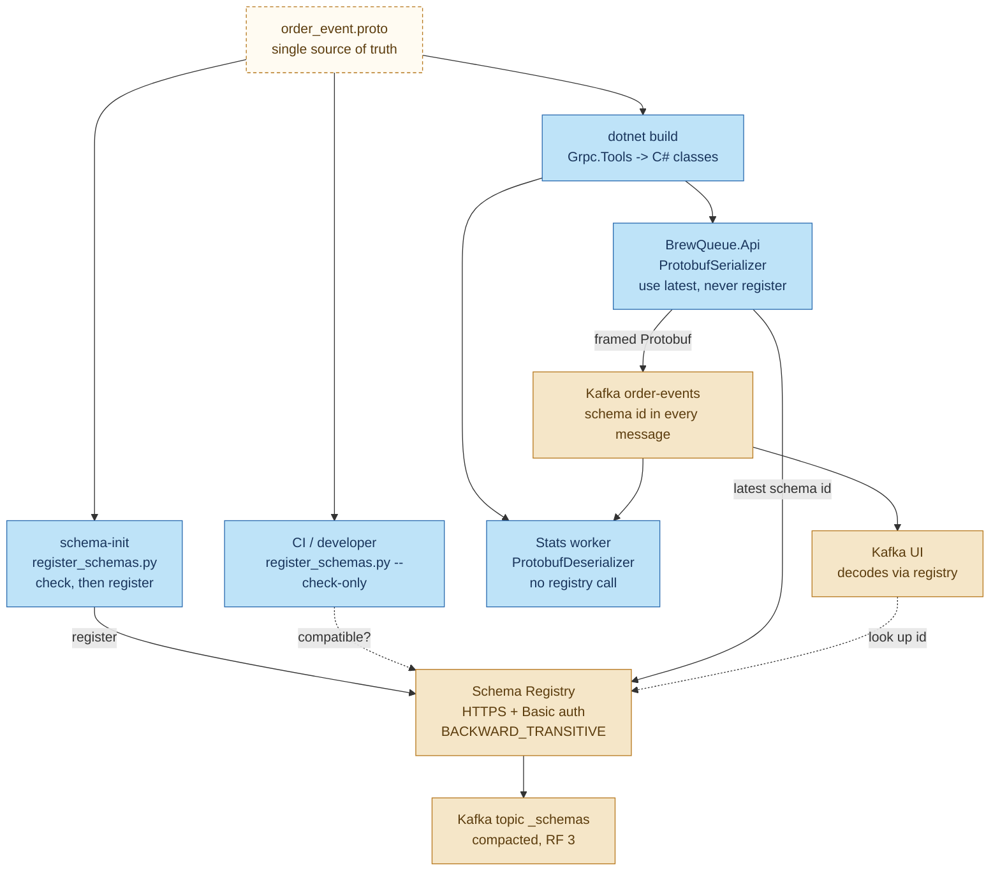
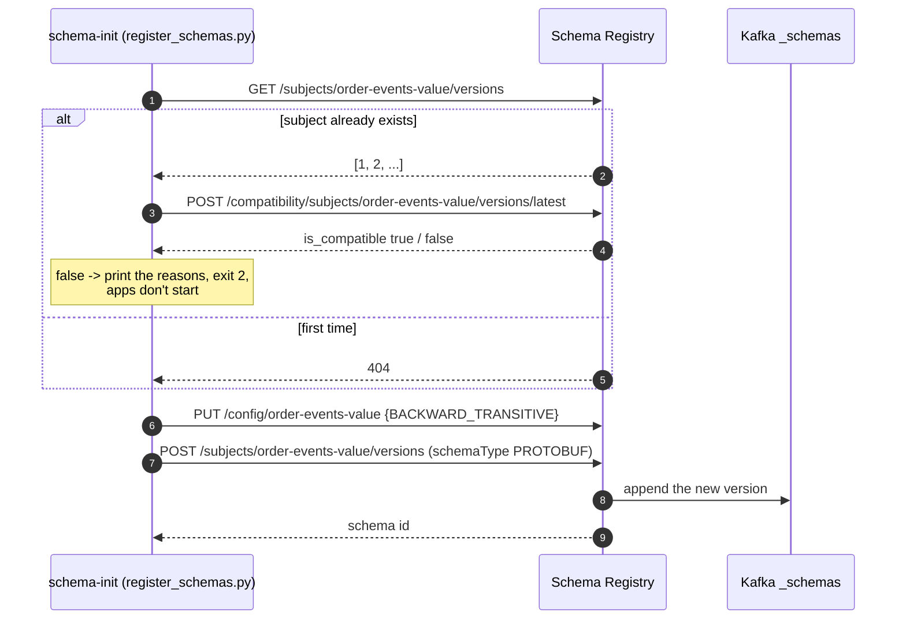
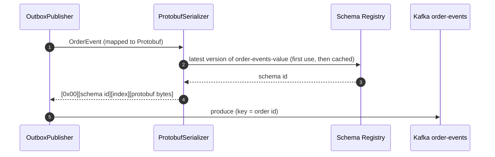
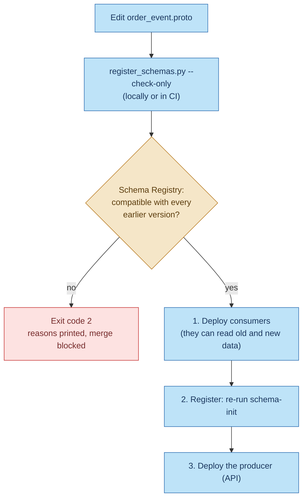

# Schema Registry in BrewQueue

This document explains what Schema Registry does in BrewQueue, how a schema moves from a `.proto`
file to the bytes on the `order-events` topic, and how a change to the event contract is checked
before it can break a consumer.

Related: [messaging-workflow.md](messaging-workflow.md) (the whole outbox -> Kafka -> consumer path)
and [kafka-production.md](kafka-production.md) (cluster, security, runbooks).

---

## Why it exists

Kafka stores bytes and never looks inside them. The API (producer) and the stats worker (consumer)
are deployed separately, so without a shared, enforced contract, one careless change on the
producer side can make every consumer misread or reject events. Nothing in Kafka would stop it.

Schema Registry is the **keeper of that contract**. It does four things here:

| Job | How |
|---|---|
| **Stores the official schema, with history** | `order_event.proto` is registered under the subject `order-events-value`. Every accepted change becomes a new version. |
| **Guards changes** | Compatibility is `BACKWARD_TRANSITIVE`. `register_schemas.py` checks a change against every earlier version before registering it, and refuses incompatible ones. |
| **Labels every message** | The API puts the registered schema id in front of every event, so each message says which schema version wrote it. |
| **Lets tools read messages** | Kafka UI (or any future consumer, in any language) looks up the schema id and decodes the Protobuf. |

It is **not** in the message path: events go from the API straight to Kafka, and the stats worker
decodes them without contacting the registry.

---

## The pieces



Sky blue = BrewQueue code and scripts. Beige = infrastructure. Dashed = checks and lookups.

The same `.proto` file is used **both** to generate the C# classes (at build time) **and** as the
schema registered in the registry. There's one source of truth, so the code and the registry can't
quietly disagree.

---

## 1. Startup: registering the schema

`docker compose up` runs the services in this order: `kafka-setup` (creates the `_schemas` topic and
the registry's Kafka ACLs), then `schema-registry`, then `schema-init`, then the apps.



- Registering an identical schema again is a no-op: the registry returns the existing id. So
  `schema-init` runs safely on every start.
- The apps depend on `schema-init` completing successfully. If a schema change is incompatible, the
  API never starts with it.

## 2. Producing: the API labels every event

Inside the API (`KafkaOrderEventPublisher`), for each outbox row:



The serializer is configured with:

| Setting | Value | Why |
|---|---|---|
| `SubjectNameStrategy` | `Topic` | Subject = `order-events-value`. Set explicitly, because newer client versions default to a different strategy. |
| `AutoRegisterSchemas` | `false` | The API can never register a schema, by accident or otherwise. |
| `UseLatestVersion` | `true` | Use the latest version registered by `schema-init`. |

The latest version is fetched once and then cached for the life of the process (the client's
default). So after a new version is registered, a running API keeps labelling events with the id it
already has until it restarts. That's why the change workflow (section 4) ends with deploying the
producer.

## 3. Consuming: decode without asking

The stats worker uses `ProtobufDeserializer` **without a registry client**:
1. It skips the 5-byte header and the message index (step 2 explains the layout).
2. It parses the rest with the generated `OrderEvent` class.
3. `OrderEventMapper.FromProto` validates the result: ids are UUIDs, a status and timestamp exist.

Anything that fails to decode or validate goes to `order-events.dlt` with a reason header.

Because the consumer never calls the registry, a registry outage can't stop consumption. Kafka UI
works differently: it looks up the schema id to show readable fields.

## 4. Changing the schema



Run the check:

```bash
SR_PASSWORD=<SR_ADMIN_PASSWORD> python3 infra/schema-registry/register_schemas.py --check-only
```

### What BACKWARD_TRANSITIVE allows

A new version must be able to read data written with **every** earlier version (`_TRANSITIVE`),
not just the previous one. That matters because Kafka keeps 14 days of events, so a replay can mix
several versions.

| Change | Result | Why |
|---|---|---|
| Add a new field (new number) | Accepted | Old data simply lacks it; readers see the default |
| Rename a field (same number and type) | Accepted | Protobuf puts numbers on the wire, not names |
| Remove a field | Accepted, but `reserved` its number and name | Readers ignore it; reusing the number later would be dangerous |
| Change a field's type (e.g. `int64` -> `string`) | **Rejected** | Old bytes can't be read as the new type |
| Reuse a removed field's number for a different type | **Rejected** | Old data would be misread |
| Move `OrderEvent` from first place in the file | Don't | The serializer identifies the message type by its position |

The integration tests in `tests/BrewQueue.IntegrationTests/SchemaRegistryTests.cs` check four of
these against a real registry: type change and number reuse are rejected; new field and rename
are accepted.

---

## Wire format

Every value on `order-events` is framed the way Confluent's serializers do it:

```
┌──────────┬───────────────────────┬─────────────────┬───────────────────────────┐
│ 0x00     │ schema id (4 bytes,   │ message index   │ Protobuf-encoded          │
│ magic    │ big-endian)           │ 0x00 = 1st msg  │ OrderEvent                │
└──────────┴───────────────────────┴─────────────────┴───────────────────────────┘
   1 byte          4 bytes            1 byte (here)         rest of the message
```

The key is the order id as a plain UTF-8 string; it isn't registered.

The contract (`src/BrewQueue.Contracts/Protos/order_event.proto`):
- **Ids** (`event_id`, `order_id`) are UUID strings.
- **Money** is in cents (`total_cents`, `unit_price_cents`), never floating point.
- **Time** is milliseconds since the Unix epoch, in UTC (`occurred_at_unix_ms`).
- **Enums** start with an `..._UNSPECIFIED = 0` value. `previous_status` is `UNSPECIFIED` for
  `OrderPlaced`.

---

## Security

| Who | Access |
|---|---|
| Clients (API, Kafka UI, schema-init) | HTTPS with our CA (`infra/kafka/secrets/public/ca.crt`) and HTTP Basic auth |
| Users | `admin` (used by schema-init and CI), `api`, `kafka-ui`. The stats worker has no user: it never calls the registry. |
| Registry -> Kafka | SCRAM user `schema-registry`, allowed only on `_schemas` and its own groups |

**Limitation:** open-source Schema Registry authenticates users but can't restrict *what* each one
may do. Any authenticated user could register a schema. Here that's contained by configuration:
the apps run with `auto.register.schemas=false`. For enforcement you'd need Confluent RBAC, Apicurio
with roles, or a gateway in front of the registry.

---

## When things go wrong

| Situation | Effect | What to do |
|---|---|---|
| Registry down when the API first publishes | Kafka outbox rows can't be serialized; they wait in the outbox | Nothing: published automatically once it's back |
| Registry down later | The API already has the schema cached and keeps publishing | Nothing |
| New version registered, API not restarted | The API keeps using the previous schema id | Restart or redeploy the API |
| Registry down, stats worker | No effect: it never calls the registry | Nothing |
| `schema-init` reports `[INCOMPATIBLE]` | Apps don't start with the new schema | Fix the `.proto` (add a field instead of changing one), or plan a new topic for a truly breaking change |
| A message with an unknown or garbled header | Stats worker dead-letters it (`dlt-reason: invalid-message`) | Inspect it in Kafka UI; replay after fixing (`infra/kafka/replay_dlt.py`) |
| API logs a Schema Registry "Subject not found" error (40401) | `schema-init` didn't run, so nothing is registered | `docker compose run --rm schema-init` |

**Truly breaking change?** If a change can't be made compatible, don't force it. Publish the new
format to a new topic (for example `order-events.v2`), migrate consumers, then retire the old topic.

---

## Where the code lives

| What | File |
|---|---|
| The contract | `src/BrewQueue.Contracts/Protos/order_event.proto` |
| C# record ↔ Protobuf mapping and validation | `src/BrewQueue.Contracts/OrderEventMapper.cs` |
| Serializer and deserializer setup | `src/BrewQueue.Infrastructure/DependencyInjection.cs` |
| Registry connection settings | `src/BrewQueue.Infrastructure/Messaging/Kafka.cs` (`SchemaRegistryOptions`) |
| Producing framed events | `src/BrewQueue.Infrastructure/Messaging/OrderEventPublisher.cs` |
| Decoding and validating in the consumer | `src/BrewQueue.Infrastructure/Stats/OrderEventProcessor.cs` |
| Registration and compatibility check | `infra/schema-registry/register_schemas.py` |
| Registry startup (users, JAAS) | `infra/schema-registry/start-schema-registry.sh` |
| Registry and schema-init services | `docker-compose.yml` |
| Compatibility tests | `tests/BrewQueue.IntegrationTests/SchemaRegistryTests.cs` |

## Useful commands

```bash
CA=infra/kafka/secrets/public/ca.crt
AUTH="admin:<SR_ADMIN_PASSWORD>"

# List subjects and versions
curl --cacert $CA -u $AUTH https://localhost:8085/subjects
curl --cacert $CA -u $AUTH https://localhost:8085/subjects/order-events-value/versions

# See the latest registered schema (id, version, text)
curl --cacert $CA -u $AUTH https://localhost:8085/subjects/order-events-value/versions/latest

# See the compatibility setting
curl --cacert $CA -u $AUTH https://localhost:8085/config/order-events-value

# Re-run registration after a .proto change
docker compose run --rm schema-init
```
